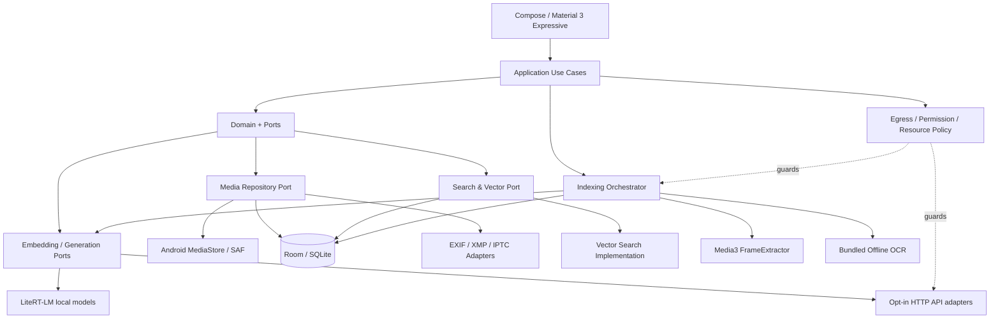

# Irohaco — Software Architecture & Technical Specification

- 文書ID: IRO-ARCH-001
- バージョン: 1.0.0
- 作成日: 2026-10-18
- 確定日: 2026-10-19
- 状態: **確定**（初版ベースライン）
- 対象プラットフォーム: Android（基準端末 1台のハイエンド機種）
- 要求仕様: [`PRD.md`](./PRD.md)
- アーキテクチャ: Android Native + Kotlin/Compose + Clean Architecture + Ports & Adapters
- 実装状況: 設計のみ。掲載コード・DBスキーマはv1.0.0の実装契約であり、実機検証は未実施。

## 0. 設計の非交渉条件

- 画像・動画は`MediaAsset`で統一し、動画は**検索可能なタイムスタンプ付きセグメント/フレーム**を必ず持つ。
- メタデータのアプリ上の正本はDB。原本EXIF変更は明示的操作と適切な権限・検証を要する。
- Embeddingモデル別に複数索引を保持する。モデル切替時に別モデルのベクトルを混ぜない。
- 通常MediaStore同期と初回AI索引を分け、AI索引の初回起動はユーザーのみがトリガーする。
- 外部AI/APIは既定無効、用途別に許可する。API障害時の無断クラウド移行を禁止する。
- ギャラリーはAIモデル未導入・破損・ロード失敗・ネットワーク遮断でも使用できる。
- AI推測、ユーザー記録、EXIF、OCRは根拠の種類と確度を分離し、原本の保存情報を無断で書き換えない。

## 1. 論理コンポーネント



**依存方向**: Presentation → Application → Domain Contracts ← Infrastructure implementations。DomainはAndroid Framework、Room、LiteRT-LM、HTTPクライアント、Rustを知らない。ApplicationはドメインUseCaseを実行し、推論・画像アクセス・永続化の具体的実装はPortで注入する。

### 1.1 推奨リポジトリ構成

```text
Irohaco/
├── app/                         # DI, Navigation, Android bootstrap
├── core/
│   ├── domain/                 # Entities / Value Objects / Policies
│   ├── contracts/              # Ports, protocol-safe DTO
│   ├── application/            # Search/Index/Metadata/RAG Use Cases
│   ├── designsystem/           # M3 tokens, components, motion
│   ├── database/               # Room schema, migrations, SQLite FTS
│   └── testing/                # Fake providers, fixture data
├── feature/
│   ├── timeline/
│   ├── albums/
│   ├── library/
│   ├── viewer/
│   ├── video-player/
│   ├── metadata-editor/
│   ├── semantic-notes/
│   ├── search/
│   ├── rag/
│   ├── model-management/
│   └── settings/
├── infrastructure/
│   ├── android-media/          # MediaStore, SAF, permissions
│   ├── metadata/               # EXIF, XMP, IPTC adapters
│   ├── frame-extraction/       # Media3 Inspector
│   ├── indexing/               # Job scheduler, checkpoint, cache
│   ├── fulltext/               # SQLite FTS
│   ├── vector/                 # Brute-force, optional ANN
│   ├── local-inference/        # LiteRT-LM
│   ├── remote-inference/       # API protocol adapters
│   ├── ocr/                    # On-device OCR
│   └── backup/                 # Versioned JSON export/import
├── native/
│   └── rust-core/              # Optional only after profiling
├── benchmark/                  # Macrobenchmark + golden retrieval
├── PRD.md
├── ARCHITECTURE.md
├── adr/                        # ADR-0001-....md
├── database/                   # 参照DDL(schema.sql)・DB設計・状態遷移
├── docs/                       # Use Case詳細・Android方針・検証計画
└── tests/                      # 参照DDLの制約テスト
```

### 1.2 主要Use Case

- `ObserveGallery` / `ListMedia` / `OpenMedia` / `PlayVideoAt`
- `SyncMediaCatalog` / `ReconcileMediaIdentity`
- `CreateOrUpdateAnnotation` / `EditMetadata` / `ExportMetadata`
- `StartAiIndexing` / `PauseAiIndexing` / `ResumeAiIndexing` / `RebuildIndex`
- `ExtractVideoSegments` / `EmbedVideoFrames` / `IndexFrameOcr`
- `SearchMedia` / `SearchSimilar` / `CompareEmbeddingSpaces`
- `AskGallery` / `ResolveEvidenceMedia`
- `RegisterModelProfile` / `AssignModelToTask` / `UpdateEgressGrant`
- `BackupUserData` / `RestoreUserData`
- データ整合性（詳細は[`docs/implementation/USE_CASES.md`](./docs/implementation/USE_CASES.md)、契約例は`core/contracts/MediaIntegrityContracts.kt`）: `EditMetadata`, `DiscoverMetadataConflicts`, `ResolveMetadataConflict`, `ExportMetadataToOriginal`, `DiscoverNewSources`, `DecideIdentity`, `RecheckMissingAssets`, `EvaluateMediaAccess`, `ReconcileAfterResume`, `RevokeDerivedAccess`, `ExportEncryptedUserData`, `PreviewEncryptedImport`, `ApplyRestore`, `VerifyRestore`

## 2. ドメインモデルと永続ID

この章の`data class`は**アプリ向けのドメインDTO/集約**であり、DBの列構成とは一致しない。永続化は3NFの正本スキーマ（[`database/DATABASE_DESIGN.md`](./database/DATABASE_DESIGN.md)）へ分解して行う。例: `MediaAsset`は`media_assets`・`media_sources`・`media_revisions`のJOIN結果、`SemanticAnnotation`は`annotation_subjects`・`semantic_annotations`・最新の`semantic_annotation_revisions`のJOIN結果。

### 2.1 MediaAsset

```kotlin
enum class MediaKind { IMAGE, VIDEO }
enum class AssetAvailability { AVAILABLE, OFFLINE, INACCESSIBLE, MISSING_CANDIDATE }

data class MediaAsset(
    val assetId: AssetId,                 // app-side UUID/ULID
    val kind: MediaKind,
    val contentUri: String?,              // 現在のContent URI。永続IDにしない
    val volumeName: String?,
    val mediaStoreId: Long?,
    val mimeType: String,
    val displayName: String,
    val sizeBytes: Long,
    val durationMs: Long?,                // video only
    val contentRevision: String,          // bytes/fingerprint/source generation
    val catalogRevision: Long,
    val availability: AssetAvailability
)
```

- MediaStore IDは端末・再スキャン・ボリューム間での永続不変キーではない。`assetId`をアプリで付与する。
- 重複・移動・復元時の再紐付けは、Volume/URI、ファイルサイズ、日付、部分ハッシュ・フルハッシュ（必要に応じて）を組み合わせて判定。**衝突・曖昧な一致を自動確定しない**。
- `MISSING_CANDIDATE`は再スキャン後の一時行方不明。アクセス権限の撤回は`INACCESSIBLE`、SD取り外しは`OFFLINE`。MISSINGは確定削除を意味しない。
- 原本のコピーや移動はユーザー操作のみ。媒体の変更に追従してタグ・メモを引き継ぐ。

### 2.2 VideoSegment / SampledFrame

```kotlin
data class VideoSegment(
    val segmentId: String,
    val assetId: AssetId,
    val startMs: Long,                    // inclusive
    val endMs: Long,                      // exclusive
    val representativeFrameMs: Long,
    val extractionProfileId: String,
    val segmentRevision: String
)

data class SampledFrame(
    val frameId: String,
    val segmentId: String,
    val timestampMs: Long,
    val decodeWidth: Int,
    val decodeHeight: Int,
    val perceptualHash: String?,
    val frameRevision: String,
    val status: FrameIndexStatus
)
```

- 半開区間`[startMs, endMs)`で統一し境界重複を回避する。
- セグメントやフレームの子IDは`assetId + extractionProfile + segment/window/timestamp + revision`の決定的生成を優先し、再処理の冪等性を保つ。
- 動画全体・シーン・代表フレームの3階層で関連付け。索引最小単位はフレームとテキストメモ、表示最小単位はシーン。
- シーン抽出は`FrameExtractor`の時刻呼び出しとシーン変化のヒューリスティックを併用。フレーム抽出の失敗や近似時刻は結果に反映する。
- 動画の再生位置はMedia3が扱うミリ秒値に揃える。根拠は`frameTimestampMs`も持つ。

### 2.3 メタデータ／注釈／位置情報

`supportingAssetIds`はDBでは`location_evidence_support`の複数行へ正規化する。

```kotlin
enum class AnnotationSource { USER, AI }
enum class AnnotationKind { CONTEXT, VISUAL_DESCRIPTION, KEYWORDS, AI_CAPTION }

data class SemanticAnnotation(
    val annotationId: String,
    val assetId: AssetId,
    val segmentId: String?,               // video segment-specific or null
    val text: String,
    val kind: AnnotationKind,
    val source: AnnotationSource,
    val searchable: Boolean,
    val revision: Long
)

enum class LocationSource { EXIF, USER, OCR, NEARBY_MEDIA, AI_INFERENCE }
enum class LocationStatus { CONFIRMED, CANDIDATE, REJECTED, UNKNOWN }

data class LocationEvidence(
    val evidenceId: String,
    val assetId: AssetId,
    val source: LocationSource,
    val status: LocationStatus,
    val latitude: Double?,
    val longitude: Double?,
    val placeText: String?,
    val confidence: Double?,
    val supportingAssetIds: List<String>,
    val explanation: String
)
```

- `originalMetadata`（読み取った値）と`effectiveMetadata`（ユーザーがアプリ内で採用した値）を分離する。EXIF由来の地点の真偽までアプリが保証するものではない。
- 機密情報を含むメモの外部API転送は画像とは別の許可対象とする。
- 元画像のピクセルを変えずメモだけ変更したら視覚Embeddingは不変。説明文/OCR/検索メモのEmbeddingは必要部分のみ更新。

## 3. Room / SQLiteスキーマ — 正本は最低3NF

**確定方針**: 正本の関係テーブルは最低でも第3正規形（3NF）とする。重複した業務属性を持つワイドテーブルや、M:NをJSON/配列に埋めた正本を禁止する。詳細な正本スキーマは以下の資料が優先される。

- [`database/DATABASE_DESIGN.md`](./database/DATABASE_DESIGN.md)：ER図、候補キー、関数従属性、FK、不変条件、Roomへの移植方針。
- [`database/schema.sql`](./database/schema.sql)：正本となる参照DDL（Room database version 1）。Roomで同等のスキーマを生成・検証する。
- [`database/INDEX_STATE_MACHINE.md`](./database/INDEX_STATE_MACHINE.md)：カタログ同期、ジョブ・索引状態遷移、クラッシュ復旧、影響範囲別の再生成方針。
- [`adr/ADR-0005-正本スキーマ第三正規形を必須とする.md`](./adr/ADR-0005-正本スキーマ第三正規形を必須とする.md)：設計判断。

### 3.1 正規化した主要関係

| 分野 | 関係 | 備考 |
|---|---|---|
| メディア | `media_assets`, `media_sources`, `media_revisions`, `asset_current_revisions` | MediaStore URIと永続asset IDを分離 |
| メタデータ | `metadata_observations`, `metadata_override_sets`, `metadata_override_values`, `metadata_sync_baselines`, `metadata_conflicts`, `location_evidence`, `location_evidence_support` | 多値編集・3-way競合・推定根拠は別関係 |
| 管理 | `tags`, `media_tags`, `albums`, `album_items`, `smart_album_rules`, `media_ratings` | 1:NとM:Nを別表へ。スマートアルバムは保存検索を参照 |
| 動画 | `frame_extraction_profiles`, `video_segments`, `sampled_frames`, `ocr_observations` | 元video→segment→frame |
| メモ | `annotation_subjects`, `semantic_annotations`, `semantic_annotation_revisions` | 動画区間か写真・動画全体かを排他的FKで区別。本文は追記式の履歴 |
| 同一性 | `media_discoveries`, `identity_candidates`, `identity_candidate_signals`, `identity_resolutions` | 新規観測を既存assetへ自動統合しない |
| アクセス | `media_access_events`, `asset_privacy_rules` | イベントは監査のみ。認可はOSへ都度照会 |
| バックアップ | `backup_archives`, `backup_archive_entries`, `restore_sessions`, `restore_asset_bindings` | 段階復元と曖昧一致の明示 |
| AI | `provider_connections`, `model_profiles`, `model_capabilities`, `embedding_spaces`, `embedding_targets`, `embedding_vectors` | 接続/モデル/空間/ベクトルの責務分離 |
| 検索 | `search_profiles`, `search_profile_spaces`, `saved_searches`, `saved_search_roots`, `search_rule_nodes`, `search_rule_set_values` | JSON条件を正本化しない |
| 処理・権限 | `indexing_jobs`, `indexing_job_items`, `egress_grants`, `task_model_assignments`, `metadata_write_operations`, `metadata_write_operation_items`, `catalog_sync_state` | 初回AI索引のユーザー操作、外部通信許可、書き戻しジャーナル |

### 3.2 正本とRead Model

SQLiteのFTS、ANNインデックス、ランキングキャッシュ、サムネイルは派生データであり、3NF正本から再構築できる。検索速度を理由とした正本の非正規化は禁止。`PRAGMA foreign_key_check`と関数従属性の設計レビューを実施する。初版はRoom database version 1として作成し、移行経路は持たない。リリース後のスキーマ変更ではMigrationTestを必須とし、`fallbackToDestructiveMigration`は禁止。

### 3.3 データ整合性の非交渉条件

- Content SHA256一致だけで自動統合しない。SD抜去は削除ではない。
- 原本への書込時はAndroid許可/再読込/ステージング/検証を必須とする。
- アプリ内部で既知の位置情報や過去のアクセスイベントはOSアクセス許可を意味しない。
- External API利用には接続/用途/ペイロードの許可と、Asset固有のremote-sendポリシーが必要。標準はdeny。
- 復元時は資格情報・送信権限・OS permissionを勝手に回復しない。
- 3NFのレビューチェックはSQLite unit testと独立した必須ゲート。

## 4. Embeddingモデルと検索空間

### 4.1 初期プロファイル

- ローカル既定Embedding: **EmbeddingGemma 2 Text-Vision 440M**（テキストと画像を共通空間へ）。動画は抽出フレームを画像として入力。
- 生成: Gemma 4 E2B IT。E4B ITはオプション。
- EmbeddingGemma 2フル740Mは動画/音声対応可能な別プロファイル候補だが、Android上の直接動画入力はモデル配布物・ランタイムの実機対応を確認した上で利用。**初期動画検索は440M+フレーム抽出で成立させる**。
- 出力次元の初期値: 768。必要があれば512/256/128を個別`EmbeddingSpace`として扱い、切り詰め後のL2再正規化を行う。

### 4.2 モデル能力の定義

```kotlin
enum class InputModality { TEXT, IMAGE, VIDEO, AUDIO }
enum class TaskType { SEARCH_QUERY, IMAGE_INDEX, VIDEO_INDEX, CAPTION, RAG, OCR_ASSIST }

data class ModelCapabilities(
    val inputs: Set<InputModality>,
    val outputEmbedding: Boolean,
    val outputText: Boolean,
    val supportsStreaming: Boolean,
    val supportsJsonSchema: Boolean,
    val supportsTools: Boolean,
    val supportsBatching: Boolean,
    val maxInputsPerCall: Int?,
    val maxVideoDurationMs: Long?
)

data class EmbeddingSpaceSpec(
    val spaceId: String,
    val modelProfileId: String,
    val modelArtifactDigest: String?,
    val dimension: Int,
    val normalization: String,
    val preprocessingProfileId: String,
    val queryTaskPrefix: String?,
    val corpusTaskPrefix: String?,
    val modalityPolicy: String
)
```

- 画像・テキストを共通検索する場合、同一モデル/次元/設定が両者で使えることを検証。単なる「768次元一致」で横断検索しない。
- プロトコル名だけでモデル能力を推定しない。接続テスト・モデル固有の能力設定を使う。
- サーバー側でモデル名同一でも内容が更新される場合、旧索引が意味的に無効になりうる。モデルRevision不明なら警告し再索引導線を提供。
- モデルのプロファイル追加・削除と、検索索引削除は別操作とする。

### 4.3 Embeddingプロバイダー契約

```kotlin
interface EmbeddingProvider {
    val profileId: String
    val capabilities: ModelCapabilities
    suspend fun embedText(input: TextEmbeddingInput): EmbeddingVector
    suspend fun embedImage(input: ImageEmbeddingInput): EmbeddingVector
    // 動画ネイティブ入力は対応する場合のみ実装する。初期はFrameExtractor経由。
    suspend fun embedVideo(input: VideoEmbeddingInput): EmbeddingVector =
        throw UnsupportedOperationException("Video embeddings not supported")
}

data class EmbeddingVector(
    val spaceId: String,
    val values: FloatArray,
    val dimension: Int,
    val normalized: Boolean
)
```

上記は契約の概念例。実装時はJava/Kotlin境界でメモリ所有権・例外型・キャンセル処理を型で表現する。`FloatArray`は境界を跨ぐ際のコピーコストがあるため計測する。

### 4.4 索引切替の状態機械

Space状態（`embedding_spaces.lifecycle_state`）とジョブ状態（`indexing_jobs.state`）は別物。状態遷移・原子的切替・冪等性の正本は[`database/INDEX_STATE_MACHINE.md`](./database/INDEX_STATE_MACHINE.md)とし、ここでは要点のみ示す。

```text
PLANNED -> BUILDING -> VERIFYING -> READY -> STALE
              ^            |          |
              +-- FAILED <-+          +--> DELETING
```

- 一時停止・再開はジョブ側（`RUNNING/PAUSING/PAUSED`）で扱い、Spaceは`BUILDING`のまま。
- **複数READYは同時維持**。切替は`search_profile_spaces`の参照変更（または検索リクエストの選択space変更）だけで行い、旧空間の削除を伴わない。
- 初回READYがまだない場合、メタデータ/全文検索は利用可能。部分索引で意味検索する場合はカバレッジを表示。
- 新空間は`VERIFYING`まで旧索引と併存させ、検証後に`search_profile_spaces`を1DBトランザクションで切替える。

## 5. 動画のAIインデックス生成パイプライン（R0 MUST）

```mermaid
flowchart TD
  Video[Video Content URI] --> Probe[Media3 metadata / decoder capability]
  Probe --> Sample[Time sampling + scene change candidates]
  Sample --> Frame[Media3 FrameExtractor]
  Frame --> Dedup[Near-duplicate filtering]
  Dedup --> Segment[Segment grouping / timestamps]
  Segment --> Embed[Image embedding per representative frame]
  Segment --> OCR[Frame OCR optional per frame]
  Embed --> Store[(EmbeddingRecords)]
  OCR --> FTS[(Text / FTS)]
  Segment --> DB[(VideoSegment / Frame)]
  Store --> Search[Hybrid retrieval]
  FTS --> Search
  DB --> Search
  Search --> Seek[Result segment -> Media3 seekTo(startMs)]
```

### 5.1 抽出方式

1. `MediaMetadataRetriever`相当で長さ、解像度、回転、メディア形式を得る。
2. `FrameExtractor`で指定時刻のフレームを抽出。タイムスタンプはミリ秒で統一し、境界補正・シーク精度を評価する。
3. Balancedモードの暫定ルールは10秒サンプリング＋シーン変化点。1動画あたりの固定フレーム上限は設けず、長尺動画は時間チャンク単位で処理し、密度と容量上限は[`docs/verification/AI_SEARCH_SPIKE.md`](./docs/verification/AI_SEARCH_SPIKE.md)の計測で決める。近いフレームのpHash/色ヒストグラムを用いて重複を間引く。シーン変化検出に粗い事前サンプルが必要なら全デコードを前提にせず段階的に処理する。
4. フレームを縮小しEmbeddingGemma 2 Image Encoderに入力。代表フレームの元映像は変更しない。
5. 隣接フレームの変化点と時間距離により`VideoSegment`を作成。シーン境界を正確に得られなければ時間窓で代替し、信頼度を低く扱う。
6. OCRは代表フレームに適用してテキスト検索用に保存する。
7. 動画セグメント単位のテキストメモは対象区間に関連付け、独立Embeddingとする。
8. 動画の編集・置換・トリム等で内容Revisionが変化したら、影響セグメントを旧Revisionとして失効し再抽出。サイズ・更新日時のみで完全な同一性を保証しない。

**品質上の限定**: 10秒サンプルでは数秒の短い出来事を見落としうる。初期リリースでは「スキャン品質」と各動画のカバレッジをUIに出し、深掘り再索引を提供する。単一サムネイルを動画全体の代表として済ませる実装は禁止。

### 5.2 動画結果の集約

- フレーム類似度上位を`segmentId`に集約。極端に近接したヒットはまとめ、異なる区間は同じ動画でも複数検索結果として返す。
- `matchedFrameMs`、`segmentStartMs/endMs`、`highlightedEvidence`を保持。
- 同じメディアが結果に多数出すぎないよう、多様性制御を設定可能にする（例: 1ページ先頭は1動画につき最大Nシーン）。
- タップで動画プレイヤーを開きシーク。時間表示は正確なフレーム位置ではなく概算になりうるため再生開始後のフレーム表示を確認。

### 5.3 後から交換できる動画Embeddingアダプター

```kotlin
interface VideoUnderstandingProvider {
    suspend fun extractVisualSegments(asset: MediaAsset, profile: VideoIndexProfile): List<VideoSegment>
    suspend fun embedVisualSegment(segment: VideoSegment): List<EmbeddingVector>
}
```

初期実装は`FrameBasedVideoProvider`。将来直接動画入力に対応するローカルモデル・外部モデルへ差し替える場合、入力制限と課金/プライバシー許可を守る。Gemini Embedding 2の動画直接入力は120秒・32フレームなどのAPI制限があるため、長時間動画の無断一括アップロードを禁止する。

## 6. 通常カタログ同期とAIジョブを分離

### 6.1 カタログ同期

- MediaStoreの画像・動画コレクションを対象とする。権限はAPIレベルと写真の部分選択権限に従う。
- `MediaStore.getVersion(volume)`で大きな変更を確認し、同一バージョン内なら`getGeneration()`と追加・更新世代を用いて差分同期。
- 既存のアプリ内注釈・索引を保持したまま新URIとの対応付けを行う。
- ユーザーの許可外に出た写真は即削除しない。`INACCESSIBLE`とし、表示・検索対象から一時除外するなど方針を明示。
- 通常カタログ表示のためのメタデータ同期はユーザーのAIインデックス開始操作を要求しない。

### 6.2 AIインデックスの実行状態

```text
User taps Start
  -> Validate model / storage / permissions / egress
  -> Enumerate eligible assets
  -> Persist job plan (idempotency keys)
  -> Process bounded batches
     image: decode -> embed -> record
     video: probe -> frames -> segments -> embed -> record
     text: OCR / annotation -> FTS + embed
  -> Save checkpoint + progress
  -> Pause at safe points when requested / OS constraints
  -> Verify output counts and readable vectors
  -> Mark READY (or PARTIAL with errors)
```

- `indexing_job_items`の`(job_id, target_id, source_revision_digest)`と`embedding_vectors`の`(space_id, target_id, source_revision_digest)`の一意性で重複実行を抑止。対象は`embedding_targets`の型別FKで表し、`sourceKind/sourceId`の文字列参照は使わない。
- 1写真や1動画の処理単位で失敗を捕捉し、ジョブ全体を停止しない。メモリ圧迫/熱しきい値超過時は適切に中断。
- 端末が再起動しても最後のコミット済みチェックポイントから再開できる。
- 初回起動はユーザー操作。以後の差分は設定を明示して有効化した場合のみWorkManagerに委譲する。
- バックグラウンドで無制限に処理できると仮定しない。Android 15+の`mediaProcessing` FGSは24h当たり合計6hなどの制約があり、Android 16のlong-running Workerもjob quotaを消費しうる。実行時間・通知・停止条件・再開方法を設計に含める。
- モデル実行中のギャラリーUIはキャッシュと別dispatcherを用い滑らかさを維持する。ユーザーの動画再生・RAG要求は索引の大量処理より優先する。

### 6.3 差分更新ルール

変更イベントごとの再読込・Embedding再生成・失効の規則は[`database/INDEX_STATE_MACHINE.md`](./database/INDEX_STATE_MACHINE.md) §6を正本とする。原則は「視覚Embeddingは映像の内容revisionが変わった時だけ再生成し、EXIF・メモの変更では作り直さない」。

## 7. Hybrid Retrieval & RAG

### 7.1 Search API契約

```kotlin
data class SearchRequest(
    val queryText: String?,
    val queryAssetId: String?,
    val profileId: String,
    val embeddingSpaceIds: List<String>,
    val includeImages: Boolean = true,
    val includeVideos: Boolean = true,
    val locationPolicy: LocationSearchPolicy,
    val filters: SearchFilters,
    val limit: Int = 100
)

data class SearchHit(
    val assetId: String,
    val segmentId: String?,
    val startMs: Long?,
    val endMs: Long?,
    val representativeFrameMs: Long?,
    val rank: Int,
    val evidence: List<SearchEvidence>,
    val indexedCoverage: Double?
)
```

`SearchEvidence`は`source=IMAGE_VECTOR|FRAME_VECTOR|ANNOTATION_VECTOR|OCR|EXIF|USER_LOCATION|INFERRED_LOCATION`、使用した`embeddingSpaceId`、出典ID、該当時間、リランキング根拠を持つ。内部スコアはデバッグ用に保持しても、モデル間の「確率」表示はしない。

### 7.2 実行ステップ

1. クエリ解析: 明示日時/年、地名、ファイル種別、メモ語、意味クエリを分離。LLMなしの決定的パーサーを基本にし、曖昧表現のLLM解析は任意。
2. 位置条件: 確定GPS/ユーザー確定と推定位置を分ける。GPSなしは意味検索やOCRで残す。
3. 各READY EmbeddingSpaceでクエリのEmbeddingを生成。写真、動画フレーム、メモのベクトルを検索する。
4. メタデータと全文(OCR、メモ、タグ)を並列検索。
5. `RRF`などで**順位**を統合。異なるモデルのコサイン値を直接比較/加算しない。
6. 同一写真・同一動画シーンのヒットを集約し、必要に応じ多様性制御・再ランキング。
7. メディアの可用性と索引範囲で除外/注記し、写真とタイムスタンプ付き動画の混在結果を表示。
8. RAG使用時は上位の**必要最小限の実画像・代表フレーム**と出典メモをGemma 4へ渡し、根拠付き回答を生成。ベクトルだけをGemma 4へ渡して画像の理解を期待しない。

### 7.3 RAG出典管理

```json
{
  "answer": "夕焼けが映る動画は2件です。",
  "citations": [
    {
      "assetId": "asset-video-01",
      "segmentId": "segment-02",
      "startMs": 72000,
      "endMs": 84000,
      "sourceType": "VIDEO_FRAME",
      "observedOrInferred": "OBSERVED"
    }
  ]
}
```

- AIの説明が根拠元に存在しない場合は推論と明示。ユーザーメモは`USER_STATED`と表示し、画像から観測できる事実と混同しない。
- Video RAGは関連セグメントのフレーム枚数を制限し、モデルの実効入力長を監視する。動画全体を常にLLMに投入しない。
- AI応答中に保存メタデータを変更する機能は提供しない（変更は確認ダイアログと編集UseCaseが必要）。

## 8. メタデータ編集・書き出しの安全性

### 8.1 保存の3段階

1. **内部DB編集**: `effectiveMetadata`を更新。検索に即時反映、原本は不変。
2. **原本に反映**: 対応形式のみ。権限確認、変更差分・バックアップ手段の案内、書き込み、再読込検証、索引更新。
3. **コピーとしてエクスポート**: 形式・権限制約やプライバシー除去に利用。原本は維持。

AndroidX `ExifInterface`での書込対応はJPEG, PNG, WebP。他形式は専用安全なwriterがない限りDB内編集またはXMPサイドカー/コピーに留める。Motion Photo、Ultra HDRなどの複合構造を破壊しない保証が取れるまでは書込を制限する。

### 8.2 ジャーナル付き更新

状態遷移（`REQUESTED → … → COMMITTED / RECOVERY_REQUIRED`）は[`database/INDEX_STATE_MACHINE.md`](./database/INDEX_STATE_MACHINE.md) §7を正本とする。ジャーナルは書き込むタグ編集とそのlocal revisionを`metadata_write_operation_items`に記録し、`COMMITTED`には書込後に再読込したrevisionを必須とする。

- AndroidのContent URIに対して常にファイルシステムレベルのatomic renameが可能とは限らない。**すべてのプロバイダーで完全トランザクション性を保証すると宣言しない**。
- 最安全パスは作業用コピーにメタデータを書き込み、再読込・メディア再生可能性の検証後、権限・プロバイダーのサポートに応じ反映する。原本置換が安全に保証できないときは「コピーの書き出し」を優先する。
- `MediaStore.createWriteRequest()`等を使用して他アプリ所有メディアへの更新許可を得る。拒否された場合はDB内編集を維持。
- 共有用のGPS除去はEXIF GPSに限らずXMP/位置を示すその他のメタデータを対象に検査し、原本でなくエクスポートコピーで実施する。

## 9. モデル登録・5 API形式

### 9.1 プロバイダーと接続方式

| Protocol ID | 形式 | 標準パス | 能力判断 |
|---|---|---|---|
| `OPENAI_CHAT` | OpenAI Chat Completions | `POST /v1/chat/completions` | 画像入力/JSON/streamはモデル依存 |
| `OPENAI_RESPONSES` | OpenAI Responses | `POST /v1/responses` | Responses固有形式・イベントに対応 |
| `ANTHROPIC_MESSAGES` | Anthropic Messages | `POST /v1/messages` | 独立アダプター、特有認証/イベント |
| `OPENAI_EMBEDDINGS` | OpenAI Embeddings | `POST /v1/embeddings` | 公式はテキスト、独自互換サーバーは手動能力設定 |
| `GEMINI_EMBED_CONTENT` | Gemini embedContent | `POST /v1beta/models/{model}:embedContent` | text/image/video等モデル能力と制限を取得 |

ベースURL・モデルID・認証方式・APIキー・カスタムヘッダー・タイムアウト・ストリーム有無をプロファイル単位で管理。APIキー空欄を許し、認証不要の明示的ローカル互換サーバーも接続可能とする（HTTPは警告）。URLのパス結合はプロトコル別に明示し、`/v1/v1`などの二重パスを防ぐ。

### 9.2 タスク別割り当てと通信許可

```kotlin
enum class EgressPayload { QUERY_TEXT, IMAGE_PIXELS, VIDEO_FRAMES, VIDEO_BYTES, OCR_TEXT, USER_ANNOTATIONS, GPS_EXIF }

// 1行 = 1つの許可。行が無ければDENY（allowedフラグは持たない）。
data class EgressGrant(
    val connectionId: String,
    val task: TaskType,
    val payload: EgressPayload,
    val grantedAt: Long
)
```

- 許可は接続先（`provider_connections`）単位で持つ。同じ接続先の複数モデルプロファイルは同じ許可を共有する。
- Asset単位の送信禁止は`asset_privacy_rules.allow_remote_send`で別に管理する。大量送信時の確認ダイアログはUI/Use Caseの責務で、DBには保存しない。

- `RAG`だけ外部許可、`IMAGE_INDEX`と`VIDEO_INDEX`は禁止、など独立設定できる。
- 設定登録時の「接続テスト」はユーザー操作で行い、テストがネットワーク通信を伴うことを明示する。実メディアを使わずサンプルで能力テストするのが既定。
- 大量外部Embedding時は対象件数と送信形式（フレーム画像・メモテキスト・OCR）の内訳を確認する。
- 画像送信時、送信用デコード画像から位置メタデータを除外。メモ本文にも地名がありうることを警告。
- 429とRetry-After、認証エラー、タイムアウト、部分バッチ成功、利用上限を明示。外部への無断再試行で重複課金しないようIdempotency管理。
- キーはAndroid Keystore保護の暗号化領域、設定の非機密部分はDataStore/Room。Keystore鍵/資格情報は通常バックアップ対象外。

### 9.3 推論Port

```kotlin
interface GenerationProvider {
    val profileId: String
    val capabilities: ModelCapabilities
    fun generate(request: GenerationRequest): kotlinx.coroutines.flow.Flow<GenerationEvent>
}

interface EgressPolicy {
    suspend fun authorize(
        task: TaskType,
        profileId: String,
        payloads: Set<EgressPayload>,
        assetIds: Set<String>
    ): EgressDecision
}
```

API通信の前に`EgressPolicy`の許可を必ず通す。UIのトグル状態だけを通信可否の唯一の判定にしない。処理途中で許可が取り消された場合は、可能な範囲で中止する。

## 10. AIリソース・並行性

### 10.1 単一のリソース調停

```text
AiResourceManager
├── ModelLifecycle: NOT_INSTALLED / READY / LOADING / LOADED / FAILED
├── PriorityQueue: USER_SEARCH > RAG > INTERACTIVE_EDIT > BACKGROUND_INDEX
├── BackendSelector: CPU/GPU capability probe
├── MemoryBudget: loaded weights / image decode / vector cache
├── ThermalAndBatteryPolicy: pause/reduce density/retry
└── Cancellation: user cancel and Android lifecycle
```

- UIは通常AIモデルをロードせず動作。EmbeddingエンジンとGemma 4エンジンの常時同時常駐を前提にしない。
- バックエンドのCPU/GPU優劣は実機で計測。自動フォールバックは**ローカル間のみ**。リモートへのフェイルオーバーは禁止。
- 温度・メモリ・バッテリーを監視してフレーム抽出/索引を減速または一時停止。Androidの制約に反して無制限のバックグラウンド稼働をしない。
- 推論のキャンセル、メモリ解放、モデル再ロード、描画バッファ圧迫時の対処をテストする。

## 11. UIアーキテクチャ

- Kotlin + Compose + Material 3 Expressive、`StateFlow<UiState>`とUnidirectional Data Flow、Navigationによる画面状態管理。
- グリッドは安定したassetIdキー、ページング、スクロール位置の復元、Coil系のサムネイルキャッシュを適切に活用。
- 詳細表示は画像と動画のビューワーを同じAssetIdで開くが、動画プレイヤーは専用モジュール。
- 検索結果の動画カードにタイムコードバッジとシーン代表フレーム。結果タップで`PlayVideoAt(assetId, startMs)`を呼ぶ。
- AIのスキャン・ダウンロードは画面を離れても進捗確認可能にする。通知可否とバックグラウンド制限を尊重。
- 写真表示の高画質デコード/HDR経路と、AI用の縮小・正規化フレーム経路を分離する。
- モデル選択UIに`READY / INDEXING / NOT_INDEXED / STALE`の状態を表示。選択時に自動外部送信や無断大量索引生成をしない。
- TalkBack、ジェスチャー代替操作、ボタンのタップ領域、動的文字サイズ、ダークモード対応。

## 12. 安定性、バックアップ、ライセンス

- 初版のDBはRoom database version 1、バックアップ形式は`format_version=1`のJSONとする。リリース後に変更する時点で、DB Migrationとエクスポート形式の変換を用意する。
- モデル配布物のダイジェスト（`model_profiles.artifact_revision`）を検証する。モデルの再ダウンロード/中断再開/削除は独立したモデル管理UIで操作する。
- ネイティブライブラリ使用時はAndroidの16KBページサイズ適合を確認。ABI、GPUドライバ、モデルバージョンでの互換性をCIと実機で検証。
- アプリ・モデル・ライブラリ・アセットのライセンスをそれぞれ確認する。アプリのOSSライセンスは別ADRで定義する。
- 難しいケース（大きいRAW、Motion Photo、HDR、非常に長い動画、SDカード、権限部分許可）は非対応でも原本を変えず、状態と回避策を提示する。

## 13. テスト計画

### 13.0 テスト環境の役割分担

| 層 | 環境 | 主な検証内容 | 実行タイミング |
| --- | --- | --- | --- |
| L1 | JVM / ホストSQLite | 3NF・制約・トリガー（`tests/`の参照DDL検証）、Domain/UseCase、DAOロジック、データ移行・インポート | PRごと（CI） |
| L2 | Android Emulator（Gradle Managed Devices） | Compose UI、MediaStore、権限変更・部分許可、Room、EXIF、動画再生/シーク、仮想SDカードの抜去/再接続 | PRごと（CI） |
| L3 | 基準端末（実機） | LiteRT-LMの実モデル推論（CPU/GPU）、速度・発熱・電力・RAM、動画インデックス生成、120Hz描画、物理SDカード、OEM固有挙動 | マイルストーンごと |

- L2の対象APIは最小API（PRD §14の候補: API 33）から最新安定版までの主要バージョン。CIの負荷に応じて組合せを絞るが、最小APIと最新APIは必ず含める。
- L2ではAIを`core/testing`のFake Providerに置き換え、機能・状態遷移のみを検証する。x86_64エミュレーターではLiteRT-LMのARM64向けGPU実装を再現できないため、実モデルの品質・速度の判定はL3でのみ行う。
- L1はAndroid/Room非依存の参照検証であり、Room実装の生成スキーマと参照DDLの一致はL2で検証する。

### 13.1 自動テスト

- Unit: ID同一性、モデル空間署名、タスク別EgressPolicy、検索クエリ解析、RRF順位統合、タイムスタンプ境界。
- Room: 生成スキーマと参照DDL（`database/schema.sql`）の一致、外部キー、複数索引の同時保持、ジョブ再開の冪等性、DBインポート。MigrationTestはversion 2を作る時点から追加。
- Integration: MediaStore権限差分、Content URIの移動、SD抜去/再接続、EXIF編集、動画フレーム抽出失敗、モデル切替。
- Contract: 5 API形式のモックサーバー、SSEイベント、429/403/timeout/partial success、モデル能力不足。
- UI: 初回オンボーディング、AI未導入ギャラリー、索引一時停止、動画再生位置、メタデータ差分、アクセシビリティ。

### 13.2 検索品質・端末性能

- Golden Set: 少なくとも写真100〜300件と異なる場面を持つ動画50件以上（暫定）。EXIF GPSあり/なし、OCR、手動メモ、多言語、長尺動画、短時間のシーン変化を含める。
- Metrics: Precision@10, Recall@20, MRR、動画ではSegment Hit@K、シーク開始誤差（ms）、カバレッジ率、索引秒/分動画、電力、熱、RAMピーク。
- 基準端末（RAM構成も記録）でCPU/GPU、量子化、フレームサンプリング、メモリ圧迫、120Hzグリッド描画を計測。
- 1万画像+500動画を性能基準データとし、実行時間は仮値。実機計測でPass/Fail閾値を見直す。

### 13.3 障害注入の例

1. 動画抽出中にプロセスkill→再起動→チェックポイントから再開、重複frameIdなし。
2. 新索引を60%作成中にキャンセル→旧READY索引は検索可能。
3. 外部APIの許可OFFのままモデルID設定→通信ゼロをモックで検証。
4. EXIF編集時に権限拒否→DB内部設定を失わず原本も変更しない。
5. 低ストレージ・バッテリー節約・熱上昇→進捗保存、一時停止、復旧可能。
6. 動画から該当フレームが得られない→誤った動画区間を成功表示しない。
7. SDカード再マウントでURI変更→対象候補を再紐付け、曖昧な同一性を保留。

## 14. リスクと防止策

| リスク | 想定障害 | 対策 |
|---|---|---|
| R-01 動画索引の膨張 | 保存量/時間/熱の増大 | フレーム上限、近接重複排除、スキャン品質、圧縮/次元削減を計測 |
| R-02 短い動画シーンの見落とし | Recall低下 | シーン変化候補、深掘り再スキャン、品質表示 |
| R-03 不安定なMediaStore識別子 | ユーザーメタデータの誤紐付け | 独立assetId、ハッシュ照合、曖昧一致は確認 |
| R-04 異なるモデルの混用 | 無意味な検索結果 | EmbeddingSpace署名、検索時の厳密な一致チェック |
| R-05 原本EXIFの破損 | 写真損傷 | DB編集優先、書込許可、コピー方式、再読込検証、形式制限 |
| R-06 予期しない通信/課金 | 写真流出・従量費用 | 用途別Allowlist、送信前プレビュー、初期OFF、ソフト予算 |
| R-07 Androidバックグラウンド制限 | 不完全な索引 | ジョブ分割、チェックポイント、FGSタイムアウト対応 |
| R-08 端末ごとの推論差 | メモリ不足・発熱 | 基準端末での計測、CPU/GPUプローブ、優先度調停、モデル解放 |
| R-09 位置推定の誤り | 誤った位置検索/EXIF汚染 | Evidence出典と確度、推定は未確定、原本自動書込禁止 |
| R-10 Google風UIを過度に模倣 | UX衝突・商標等の懸念 | Material公式コンポーネント採用、ブランド/固有画面コピー禁止 |

## 15. ADR一覧

| ADR | 決定 |
|---|---|
| [ADR-0001](./adr/ADR-0001-Androidネイティブ採用.md) | AndroidネイティブとKotlin-firstを採用 |
| [ADR-0002](./adr/ADR-0002-ローカルファーストと外部API許可.md) | ローカルファーストと外部API許可 |
| [ADR-0003](./adr/ADR-0003-Embedding空間分離と切替.md) | Embedding空間を独立保持し即時切替可能にする |
| [ADR-0004](./adr/ADR-0004-メタデータDB正本と原本安全編集.md) | メタデータはDB正本とし原本編集を明示操作にする |
| [ADR-0005](./adr/ADR-0005-正本スキーマ第三正規形を必須とする.md) | 正本データベースは最低でも第三正規形を必須とする |
| [ADR-0006](./adr/ADR-0006-動画AI検索を初期必須機能とする.md) | 動画のシーン検索を初期リリースの必須機能とする |
| [ADR-0007](./adr/ADR-0007-メタデータ競合解決と多値管理.md) | メタデータ競合解決と多値管理 |
| [ADR-0008](./adr/ADR-0008-メディア同一性と誤統合防止.md) | メディア同一性と誤統合防止 |
| [ADR-0009](./adr/ADR-0009-アクセス権限と検索隔離.md) | アクセス権限と検索隔離 |
| [ADR-0010](./adr/ADR-0010-バックアップと復元の明示操作.md) | バックアップと復元の明示操作 |

未起票: モデル能力ベースのAPIアダプター、EXIF書き戻しの対応形式、アプリのOSSライセンス。

## 16. 最初の技術検証（アーキテクチャの成立条件）

詳細な実施計画・測定項目・合格条件は[`docs/verification/AI_SEARCH_SPIKE.md`](./docs/verification/AI_SEARCH_SPIKE.md)を正本とする。未実行の計画であり、現時点の性能保証ではない。

**Spike A: 動画検索の成立**
- 基準端末で動画のフレーム抽出・Embedding保存・日本語検索・時刻へのシークを縦貫で実装。
- 代表フレームの抽出レート/上限によるRecallと熱負荷を比較。
- 基準シーンを探索できない場合、R0動画要件を延期するのではなく抽出密度・セグメント化・モデル条件を見直す。

**Spike B: 2つのEmbedding索引共存**
- 同じ写真と動画セグメントを2つの空間に登録。インデックスの指紋による隔離・READYの切替・旧空間保持・失効処理を検証。

**Spike C: MediaStoreデータ永続性**
- 移動、リネーム、権限変更、SD抜去/復帰、ファイル複製、原本書き戻しを繰り返し、タグと注釈の紐付けが破損しないか検証。

**Spike D: リモートAPIの安全な分離**
- 5形式の接続設定を登録し、用途別許可がOFFならテスト環境でネットワークアクセスが発生しないことを検証。

## 17. 主要公式資料（2026-10-18）

- Material 3 Compose: https://developer.android.com/develop/ui/compose/designsystems/material3
- MediaStore access / generation / edits: https://developer.android.com/training/data-storage/shared/media
- Partial visual access: https://developer.android.com/about/versions/14/changes/partial-photo-video-access
- Media3 FrameExtractor: https://developer.android.com/media/media3/inspector/extract-frames
- Media3 MetadataRetriever: https://developer.android.com/media/media3/inspector/retrieve-metadata
- AndroidX ExifInterface: https://developer.android.com/reference/androidx/exifinterface/media/ExifInterface
- Foreground service timeouts: https://developer.android.com/develop/background-work/services/fgs/timeout
- Long-running WorkManager: https://developer.android.com/develop/background-work/background-tasks/persistent/how-to/long-running
- EmbeddingGemma 2: https://ai.google.dev/gemma/docs/embeddinggemma/model_card_2
- EmbeddingGemma 2 Android LiteRT-LM 440M: https://huggingface.co/litert-community/embeddinggemma-2-text-vision-440m-litert-lm
- Gemma 4: https://ai.google.dev/gemma/docs/core
- Gemini multimodal embeddings: https://ai.google.dev/gemini-api/docs/embeddings
- ML Kit OCR: https://developers.google.com/ml-kit/vision/text-recognition/v2/android
