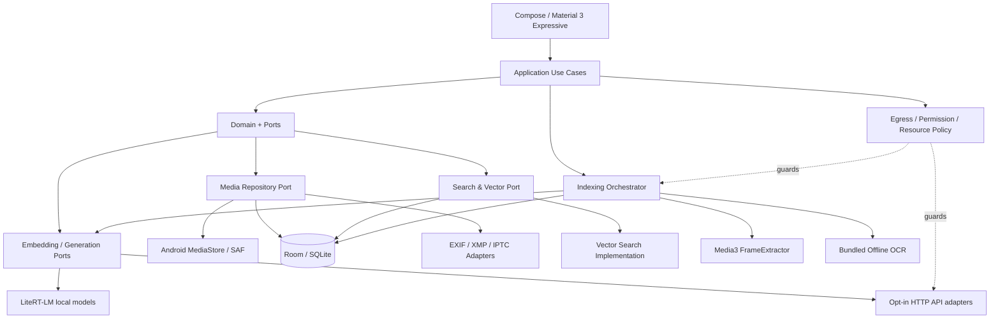

# Irohaco Software Architecture & Technical Specification

- 文書ID: IRO-ARCH-001
- バージョン: 1.0.0
- 作成日: 2026-10-18
- 確定日: 2026-10-19
- 状態: 確定
- 対象プラットフォーム: Android（ハイエンド機種1台を基準端末とする）
- 要求仕様: [`PRD.md`](./PRD.md)
- アーキテクチャ: Android Native + Kotlin/Compose + Clean Architecture + Ports & Adapters
- 実装状況: 設計のみ。この文書のコードとDBスキーマはv1.0.0の実装方針を示すもので、実機での検証はまだ行っていない。

## 0. 設計上の前提

- 画像と動画は`MediaAsset`で統一して扱う。動画には検索できるタイムスタンプ付きのセグメントとフレームを必ず持たせる。
- アプリ上のメタデータはDBの値を正とする。原本のEXIFを変えるには、明示的な操作と、適切な権限と、検証が必要である。
- Embeddingモデルごとに別々の索引を持つ。モデルを切り替えるときに、別のモデルのベクトルを混ぜない。
- 通常のMediaStoreの同期と最初のAI索引は分け、最初のAI索引はユーザーの操作でだけ始める。
- 外部のAIとAPIは既定で無効にし、用途ごとに許可する。APIの障害時に、無断でクラウドへ切り替えない。
- ギャラリーは、AIモデルが未導入、破損、ロードの失敗、ネットワークの遮断のどの場合でも使える。
- AIの推測、ユーザーの記録、EXIF、OCRは、根拠の種類と確度を分けて持ち、原本に保存されている情報を無断で書き換えない。

## 1. 論理コンポーネント



依存の向きは Presentation → Application → Domain Contracts ← Infrastructure implementations とする。DomainはAndroid Framework、Room、LiteRT-LM、HTTPクライアント、Rustを参照しない。ApplicationはドメインのUseCaseを実行し、推論、画像へのアクセス、永続化の具体的な実装はPortを通して注入する。

### 1.1 推奨リポジトリ構成

```text
Irohaco/
├── app/                         # DI, Navigation, Android bootstrap
├── core/
│   ├── domain/                 # Entities / Value Objects / Policies
│   ├── contracts/              # Ports, protocol-safe DTO
│   ├── application/            # Search/Index/Metadata/RAG Use Cases
│   ├── designsystem/           # M3 tokens, components, motion
│   ├── database/               # Room schema, migrations, SQLite FTS
│   └── testing/                # Fake providers, fixture data
├── feature/
│   ├── timeline/
│   ├── albums/
│   ├── library/
│   ├── viewer/
│   ├── video-player/
│   ├── metadata-editor/
│   ├── semantic-notes/
│   ├── search/
│   ├── rag/
│   ├── model-management/
│   └── settings/
├── infrastructure/
│   ├── android-media/          # MediaStore, SAF, permissions
│   ├── metadata/               # EXIF, XMP, IPTC adapters
│   ├── frame-extraction/       # Media3 Inspector
│   ├── indexing/               # Job scheduler, checkpoint, cache
│   ├── fulltext/               # SQLite FTS
│   ├── vector/                 # Brute-force, optional ANN
│   ├── local-inference/        # LiteRT-LM
│   ├── remote-inference/       # API protocol adapters
│   ├── ocr/                    # On-device OCR
│   └── backup/                 # Versioned JSON export/import
├── native/
│   └── rust-core/              # Optional only after profiling
├── benchmark/                  # Macrobenchmark + golden retrieval
├── PRD.md
├── ARCHITECTURE.md
├── DESIGN.md                   # UIデザインシステム（M3 Expressive）
├── CONTRIBUTING.md             # Issue駆動・Git Flow・設計原則
├── .github/                    # Issue/PRテンプレート、CI
├── adr/                        # ADR-0001-....md
├── database/                   # 参照DDL(schema.sql)・DB設計・状態遷移
├── docs/                       # Use Case詳細・Android方針・検証計画・ロードマップ
└── tests/                      # 参照DDLの制約テスト
```

ビルドの構成は次のとおりとする。

| 項目 | 値 |
|---|---|
| minSdk | 33（PRD §14の候補。基準端末と依存ランタイムを確かめて変えるときは、こことPRD §14を直す） |
| compileSdk / targetSdk | 37 |
| ビルド | Gradle 9.8.1、Android Gradle Plugin 9.4.1、Kotlin 2.4.21、JDK 17 |
| 依存のバージョン | `gradle/libs.versions.toml`で管理する |
| 開発環境 | `.devcontainer/`のDockerイメージで、JDKとAndroid SDKをそろえてビルドする |

`core/domain`と`core/contracts`は純粋なKotlinのモジュールとし、AndroidX、Room、LiteRT-LM、HTTPクライアントの依存を宣言するとビルドが失敗する（ルートの`build.gradle.kts`）。値オブジェクトと不変条件は`core/domain`に、Portと表示用のViewは`core/contracts`に置く。

### 1.2 主なUse Case

- `ObserveGallery` / `ListMedia` / `OpenMedia` / `PlayVideoAt`
- `SyncMediaCatalog` / `ReconcileMediaIdentity`
- `CreateOrUpdateAnnotation` / `ExportMetadata`
- `StartAiIndexing` / `PauseAiIndexing` / `ResumeAiIndexing` / `RebuildIndex`
- `ExtractVideoSegments` / `EmbedVideoFrames` / `IndexFrameOcr`
- `SearchMedia` / `SearchSimilar` / `CompareEmbeddingSpaces`
- `AskGallery` / `ResolveEvidenceMedia`
- `RegisterModelProfile` / `AssignModelToTask` / `UpdateEgressGrant`
- `BackupUserData` / `RestoreUserData`
- データ整合性に関するもの（詳しくは[`docs/implementation/USE_CASES.md`](./docs/implementation/USE_CASES.md)、インターフェースは`core/contracts/src/main/kotlin/dev/irohaco/core/contracts/MediaIntegrityContracts.kt`）: `EditMetadata`, `DiscoverMetadataConflicts`, `ResolveMetadataConflict`, `ExportMetadataToOriginal`, `DiscoverNewSources`, `DecideIdentity`, `RecheckMissingAssets`, `EvaluateMediaAccess`, `ReconcileAfterResume`, `RevokeDerivedAccess`, `ExportEncryptedUserData`, `PreviewEncryptedImport`, `ApplyRestore`, `VerifyRestore`

## 2. ドメインモデルと永続ID

この章の`data class`はアプリ向けのドメインDTOと集約で、DBの列構成とは一致しない。永続化するときは、3NFのスキーマ（[`database/DATABASE_DESIGN.md`](./database/DATABASE_DESIGN.md)）に分解して保存する。たとえば`MediaAsset`は`media_assets`、`media_sources`、`media_revisions`をJOINした結果で、`SemanticAnnotation`は`annotation_subjects`、`semantic_annotations`、最新の`semantic_annotation_revisions`をJOINした結果である。

### 2.1 MediaAsset

```kotlin
enum class MediaKind { IMAGE, VIDEO }
enum class AssetAvailability { AVAILABLE, OFFLINE, INACCESSIBLE, MISSING_CANDIDATE }

data class MediaAsset(
    val assetId: AssetId,                 // app-side UUID/ULID
    val kind: MediaKind,
    val contentUri: String?,              // 現在のContent URI。永続IDにしない
    val volumeName: String?,
    val mediaStoreId: Long?,
    val mimeType: String,
    val displayName: String,
    val sizeBytes: Long,
    val durationMs: Long?,                // video only
    val contentRevision: String,          // bytes/fingerprint/source generation
    val catalogRevision: Long,
    val availability: AssetAvailability   // DBでは media_sources.access_state
)
```

- MediaStoreのIDは端末、再スキャン、ボリュームをまたいで変わらないキーではない。そのため`assetId`をアプリで付ける。
- 重複、移動、復元のときの対応付けは、ボリュームとURI、ファイルサイズ、日付、部分ハッシュと（必要なら）フルハッシュを組み合わせて判断する。衝突やあいまいな一致は自動で確定しない。
- `MISSING_CANDIDATE`は、再スキャンで一時的に見つからなくなった状態である。アクセス権限が取り消されたときは`INACCESSIBLE`、SDカードを取り外したときは`OFFLINE`にする。`MISSING_CANDIDATE`は削除が確定したことを意味しない。
- 原本のコピーと移動はユーザーの操作でだけ行う。メディアが移っても、タグとメモを引き継ぐ。

### 2.2 VideoSegment / SampledFrame

```kotlin
data class VideoSegment(
    val segmentId: String,
    val assetId: AssetId,
    val startMs: Long,                    // inclusive
    val endMs: Long,                      // exclusive
    val representativeFrameMs: Long,
    val extractionProfileId: String,
    val segmentRevision: String
)

data class SampledFrame(
    val frameId: String,
    val segmentId: String,
    val timestampMs: Long,
    val decodeWidth: Int,
    val decodeHeight: Int,
    val perceptualHash: String?,
    val frameRevision: String,
    val status: FrameIndexStatus
)
```

- 区間は半開区間`[startMs, endMs)`にそろえ、境界が重ならないようにする。
- セグメントとフレームの子IDは、`assetId + extractionProfile + segment/window/timestamp + revision`から決まった値で作ることを優先し、同じ処理をやり直しても結果が変わらないようにする。
- 動画全体、シーン、代表フレームの3階層で関連付ける。索引の最小単位はフレームとテキストのメモ、表示の最小単位はシーンとする。
- シーンの抽出には`FrameExtractor`で時刻を指定して取り出す方法と、シーンの変化を見つけるヒューリスティックを併用する。フレームの抽出に失敗したことや、時刻が近似値であることは結果に反映する。
- 動画の再生位置は、Media3が扱うミリ秒の値にそろえる。根拠には`frameTimestampMs`も持たせる。

### 2.3 メタデータ／注釈／位置情報

`supportingAssetIds`は、DBでは`location_evidence_support`の複数の行に正規化する。

```kotlin
enum class AnnotationSource { USER, AI }
enum class AnnotationKind { CONTEXT, VISUAL_DESCRIPTION, KEYWORDS, AI_CAPTION }

data class SemanticAnnotation(
    val annotationId: String,
    val assetId: AssetId,
    val segmentId: String?,               // video segment-specific or null
    val text: String,
    val kind: AnnotationKind,
    val source: AnnotationSource,
    val searchable: Boolean,
    val revision: Long
)

enum class LocationSource { EXIF, USER, OCR, NEARBY_MEDIA, AI_INFERENCE }
enum class LocationStatus { CONFIRMED, CANDIDATE, REJECTED, UNKNOWN }

data class LocationEvidence(
    val evidenceId: String,
    val assetId: AssetId,
    val source: LocationSource,
    val status: LocationStatus,
    val latitude: Double?,
    val longitude: Double?,
    val placeText: String?,
    val confidence: Double?,
    val supportingAssetIds: List<String>,
    val explanation: String
)
```

- `originalMetadata`（読み取った値）と`effectiveMetadata`（ユーザーがアプリ内で採用した値）を分けて持つ。EXIFに書かれた地点が正しいかどうかまでは、アプリは保証しない。
- 機密情報を含むメモを外部APIへ送るときは、画像とは別に許可を得る。
- 元の画像のピクセルを変えずにメモだけを変えたときは、画像のEmbeddingは変えない。説明文、OCR、検索メモのEmbeddingは、必要な部分だけを更新する。

## 3. Room / SQLiteスキーマ（基本テーブルは3NF以上）

基本テーブル（派生データ以外のテーブル）はすべて第3正規形（3NF）以上にすることを確定した方針とする。同じ業務上の属性を重複して持つ横長のテーブルや、多対多の関係をJSONや配列に詰めた基本テーブルは禁止する。スキーマの詳細はこの文書より次の資料を優先する。

- [`database/DATABASE_DESIGN.md`](./database/DATABASE_DESIGN.md): ER図、候補キー、関数従属性、FK、不変条件、Roomへの移植の方針。
- [`database/schema.sql`](./database/schema.sql): 参照用のDDL（Room database version 1）。Roomで同じスキーマを作り、一致を検証する。
- [`database/INDEX_STATE_MACHINE.md`](./database/INDEX_STATE_MACHINE.md): カタログの同期、ジョブと索引の状態遷移、クラッシュからの復旧、変更の影響範囲ごとの作り直しの方針。
- [`adr/ADR-0005-正本スキーマ第三正規形を必須とする.md`](./adr/ADR-0005-正本スキーマ第三正規形を必須とする.md): この判断の記録。

### 3.1 正規化した主な関係

| 分野 | 関係 | 備考 |
|---|---|---|
| メディア | `media_assets`, `media_sources`, `media_revisions`, `asset_current_revisions` | MediaStoreのURIと永続的なasset IDを分ける |
| メタデータ | `metadata_observations`, `metadata_override_sets`, `metadata_override_values`, `metadata_sync_baselines`, `metadata_conflicts`, `location_evidence`, `location_evidence_support` | 複数の値の編集、3-wayの競合、推定の根拠は別の関係にする |
| 管理 | `tags`, `media_tags`, `albums`, `album_items`, `smart_album_rules`, `media_ratings` | 1対多と多対多を別の表にする。スマートアルバムは保存した検索を参照する |
| 動画 | `frame_extraction_profiles`, `video_segments`, `sampled_frames`, `ocr_observations` | 元の動画、セグメント、フレームの順に関連付ける |
| メモ | `annotation_subjects`, `semantic_annotations`, `semantic_annotation_revisions` | 動画の区間か、写真や動画の全体かを、排他的なFKで区別する。本文は追記していく履歴にする |
| 同一性 | `media_discoveries`, `identity_candidates`, `identity_candidate_signals`, `identity_resolutions` | 新しく見つかったメディアを既存のassetへ自動で統合しない |
| アクセス | `media_access_events`, `asset_privacy_rules` | イベントは監査のためだけに使い、認可はそのつどOSに問い合わせる |
| バックアップ | `backup_archives`, `backup_archive_entries`, `restore_sessions`, `restore_asset_bindings` | 段階的に復元し、あいまいな一致は状態として明示する |
| AI | `provider_connections`, `model_profiles`, `model_capabilities`, `embedding_spaces`, `embedding_targets`, `embedding_vectors` | 接続、モデル、空間、ベクトルで責務を分ける |
| 検索 | `search_profiles`, `search_profile_spaces`, `saved_searches`, `saved_search_roots`, `search_rule_nodes`, `search_rule_set_values` | 検索条件をJSONのまま基本テーブルに入れない |
| 処理と権限 | `indexing_jobs`, `indexing_job_items`, `egress_grants`, `task_model_assignments`, `metadata_write_operations`, `metadata_write_operation_items`, `catalog_sync_state` | 最初のAI索引を始めたユーザーの操作、外部通信の許可、書き戻しのジャーナル |

### 3.2 基本テーブルとRead Model

SQLiteのFTS、ANNのインデックス、ランキングのキャッシュ、サムネイルは派生データで、3NFの基本テーブルから作り直せる。検索を速くするために基本テーブルを非正規化することは禁止する。`PRAGMA foreign_key_check`と、関数従属性の設計レビューを行う。初版はRoom database version 1として作り、移行の経路は持たない。リリース後にスキーマを変えるときはMigrationTestを必須とし、`fallbackToDestructiveMigration`は禁止する。

### 3.3 データ整合性の前提

- コンテンツのSHA256が一致しただけで自動統合しない。SDカードを抜いたことは削除ではない。
- 原本に書き込むときは、Androidの許可、読み込み直し、作業用コピーへの書き込み、検証を必須とする。
- アプリ内部で分かっている位置情報や過去のアクセスのイベントは、OSのアクセス許可の代わりにならない。
- 外部APIを使うには、接続、用途、送る内容のそれぞれの許可と、Assetごとの外部送信のポリシーが必要である。標準は拒否とする。
- 復元のときは、資格情報、送信の権限、OSのpermissionを勝手に戻さない。
- 3NFのレビューはSQLiteのユニットテストとは別の必須の確認とする。

## 4. Embeddingモデルと検索空間

### 4.1 初期のプロファイル

- ローカルの既定のEmbeddingはEmbeddingGemma 2 Text-Vision 440M（テキストと画像を同じ空間に写す）とする。動画は抽出したフレームを画像として入力する。
- 生成にはGemma 4 E2B ITを使い、E4B ITは任意とする。
- EmbeddingGemma 2のフル構成（740M）は動画と音声も扱えるため、別のプロファイルの候補になる。ただしAndroid上で動画を直接入力するのは、モデルの配布物とランタイムが実機で対応していると確かめてからにする。初期の動画検索は440Mとフレームの抽出で成り立たせる。
- 出力の次元の初期値は768とする。必要なら512、256、128をそれぞれ別の`EmbeddingSpace`として扱い、切り詰めたあとにL2で正規化し直す。

### 4.2 モデルの能力の定義

```kotlin
enum class InputModality { TEXT, IMAGE, VIDEO, AUDIO }
enum class TaskType { SEARCH_QUERY, IMAGE_INDEX, VIDEO_INDEX, CAPTION, RAG, OCR_ASSIST }

data class ModelCapabilities(
    val inputs: Set<InputModality>,
    val outputEmbedding: Boolean,
    val outputText: Boolean,
    val supportsStreaming: Boolean,
    val supportsJsonSchema: Boolean,
    val supportsTools: Boolean,
    val supportsBatching: Boolean,
    val maxInputsPerCall: Int?,
    val maxVideoDurationMs: Long?
)

data class EmbeddingSpaceSpec(
    val spaceId: String,
    val modelProfileId: String,
    val modelArtifactDigest: String?,
    val dimension: Int,
    val normalization: String,
    val preprocessingProfileId: String,
    val queryTaskPrefix: String?,
    val corpusTaskPrefix: String?,
    val modalityPolicy: String
)
```

- 画像とテキストをまとめて検索するときは、両方で同じモデル、次元、設定を使えることを確かめる。「どちらも768次元」というだけで横断検索はしない。
- プロトコルの名前だけでモデルの能力を推定しない。接続テストと、モデルごとの能力の設定を使う。
- サーバー側でモデル名が同じまま中身が更新されると、古い索引の意味が通らなくなることがある。モデルのRevisionが分からないときは警告を出し、再索引へ進めるようにする。
- モデルのプロファイルの追加と削除は、検索の索引の削除とは別の操作にする。

### 4.3 Embeddingプロバイダーのインターフェース

```kotlin
interface EmbeddingProvider {
    val profileId: String
    val capabilities: ModelCapabilities
    suspend fun embedText(input: TextEmbeddingInput): EmbeddingVector
    suspend fun embedImage(input: ImageEmbeddingInput): EmbeddingVector
    // 動画ネイティブ入力は対応する場合のみ実装する。初期はFrameExtractor経由。
    suspend fun embedVideo(input: VideoEmbeddingInput): EmbeddingVector =
        throw UnsupportedOperationException("Video embeddings not supported")
}

data class EmbeddingVector(
    val spaceId: String,
    val values: FloatArray,
    val dimension: Int,
    val normalized: Boolean
)
```

上のコードは考え方を示す例である。実装では、JavaとKotlinの境界でのメモリの所有権、例外の型、キャンセルの扱いを型で表す。`FloatArray`は境界をまたぐときにコピーの負荷がかかるので、計測する。

### 4.4 索引の切り替えの状態遷移

空間の状態（`embedding_spaces.lifecycle_state`）とジョブの状態（`indexing_jobs.state`）は別のものである。状態遷移、まとめての切り替え、冪等性は[`database/INDEX_STATE_MACHINE.md`](./database/INDEX_STATE_MACHINE.md)に従い、ここでは要点だけを示す。

```text
PLANNED -> BUILDING -> VERIFYING -> READY -> STALE
              ^            |          |
              +-- FAILED <-+          +--> DELETING
```

- 一時停止と再開はジョブの側（`RUNNING/PAUSING/PAUSED`）で扱い、空間は`BUILDING`のままにする。
- READYの空間は複数を同時に保持する。切り替えは`search_profile_spaces`の参照を変えるか、検索リクエストで選ぶ空間を変えるだけで行い、古い空間は削除しない。
- READYの空間がまだ1つもないときも、メタデータの検索と全文検索は使える。作成途中の索引で意味の検索をするときは、カバレッジを表示する。
- 新しい空間は`VERIFYING`が終わるまで古い索引と並べて持ち、検証が済んだら`search_profile_spaces`を1つのDBトランザクションで切り替える。

## 5. 動画のAIインデックス作成パイプライン（R0で必須）

```mermaid
flowchart TD
  Video[Video Content URI] --> Probe[Media3 metadata / decoder capability]
  Probe --> Sample[Time sampling + scene change candidates]
  Sample --> Frame[Media3 FrameExtractor]
  Frame --> Dedup[Near-duplicate filtering]
  Dedup --> Segment[Segment grouping / timestamps]
  Segment --> Embed[Image embedding per representative frame]
  Segment --> OCR[Frame OCR optional per frame]
  Embed --> Store[(EmbeddingRecords)]
  OCR --> FTS[(Text / FTS)]
  Segment --> DB[(VideoSegment / Frame)]
  Store --> Search[Hybrid retrieval]
  FTS --> Search
  DB --> Search
  Search --> Seek[Result segment -> Media3 seekTo(startMs)]
```

### 5.1 抽出の方法

1. Media3の`MetadataRetriever`などで、長さ、解像度、回転、メディアの形式を取得する。
2. `FrameExtractor`で指定した時刻のフレームを取り出す。タイムスタンプはミリ秒にそろえ、境界の補正とシークの精度を評価する。
3. Balancedモードの暫定のルールは、10秒ごとのサンプリングとシーンの変化点とする。1本の動画のフレーム数に固定の上限は設けず、長い動画は時間のチャンクごとに処理する。密度と容量の上限は、[`docs/verification/AI_SEARCH_SPIKE.md`](./docs/verification/AI_SEARCH_SPIKE.md)の計測で決める。近いフレームはpHashと色のヒストグラムで比べて重複を減らす。シーンの変化を見つけるために粗いサンプルが先に必要なら、全フレームのデコードを前提にせず段階的に処理する。
4. フレームを縮小して、EmbeddingGemma 2の画像エンコーダーに入力する。代表フレームの元の映像は変えない。
5. 隣り合うフレームの変化点と時間の距離から`VideoSegment`を作る。シーンの境界を正確に取れないときは時間の幅で区切り、信頼度を低く扱う。
6. 代表フレームにOCRをかけ、テキスト検索のために保存する。
7. 動画のセグメントに付けたテキストのメモは、その区間に関連付けて独立したEmbeddingにする。
8. 動画の編集、置き換え、トリムなどで内容のRevisionが変わったら、影響を受けるセグメントを古いRevisionとして無効にし、抽出し直す。サイズと更新日時だけで同一だと断定しない。

10秒ごとのサンプリングでは、数秒しかない短い出来事を見落とすことがある。そのため初期リリースでは「スキャン品質」と動画ごとのカバレッジを画面に出し、より細かく索引し直す操作を用意する。1枚のサムネイルを動画全体の代表として済ませる実装は禁止する。

### 5.2 動画の結果のまとめ方

- フレームの類似度の上位を`segmentId`ごとにまとめる。非常に近い位置のヒットは1つにまとめ、異なる区間は同じ動画でも別々の検索結果として返す。
- `matchedFrameMs`、`segmentStartMs/endMs`、`highlightedEvidence`を持つ。
- 同じメディアが結果に並びすぎないよう、多様性を調整できるようにする（例: 1ページ目の上位では1本の動画につき最大Nシーン）。
- タップすると動画プレイヤーを開いてシークする。表示する時刻は正確なフレームの位置ではなく概算になることがあるので、再生を始めたあとのフレームの表示を確かめる。

### 5.3 あとから差し替えられる動画のEmbeddingアダプター

```kotlin
interface VideoUnderstandingProvider {
    suspend fun extractVisualSegments(asset: MediaAsset, profile: VideoIndexProfile): List<VideoSegment>
    suspend fun embedVisualSegment(segment: VideoSegment): List<EmbeddingVector>
}
```

初期の実装は`FrameBasedVideoProvider`とする。将来、動画を直接入力できるローカルのモデルや外部のモデルへ差し替えるときも、入力の制限と、課金とプライバシーの許可を守る。Gemini Embedding 2に動画を直接入力するときは、120秒、32フレームといったAPIの制限があるので、長い動画を無断でまとめてアップロードすることは禁止する。

## 6. 通常のカタログ同期とAIジョブを分ける

### 6.1 カタログ同期

- MediaStoreの画像と動画のコレクションを対象にする。権限はAPIレベルと、写真の部分的な選択の権限に従う。
- `MediaStore.getVersion(volume)`で大きな変更を確かめ、同じバージョンの中なら`getGeneration()`と追加、更新の世代を使って差分を同期する。
- アプリ内の既存の注釈と索引を残したまま、新しいURIとの対応を付ける。
- ユーザーが許可した範囲から外れた写真は、すぐには削除しない。`INACCESSIBLE`にして、表示と検索の対象から一時的に外すなど、扱いを画面に示す。
- 通常のカタログ表示のためのメタデータの同期には、ユーザーがAIインデックスを開始する操作を必要としない。

### 6.2 AIインデックスの実行の流れ

```text
User taps Start
  -> Validate model / storage / permissions / egress
  -> Enumerate eligible assets
  -> Persist job plan (idempotency keys)
  -> Process bounded batches
     image: decode -> embed -> record
     video: probe -> frames -> segments -> embed -> record
     text: OCR / annotation -> FTS + embed
  -> Save checkpoint + progress
  -> Pause at safe points when requested / OS constraints
  -> Verify output counts and readable vectors
  -> Mark READY (or PARTIAL with errors)
```

- `indexing_job_items`の`(job_id, target_id, source_revision_digest)`と、`embedding_vectors`の`(space_id, target_id, source_revision_digest)`を一意にして、同じ処理が二重に走らないようにする。対象は`embedding_targets`の種類ごとのFKで表し、`sourceKind/sourceId`のような文字列での参照は使わない。
- 失敗は写真1枚、動画1本の単位で受け止め、ジョブ全体を止めない。メモリが逼迫したときや温度が閾値を超えたときは、適切に中断する。
- 端末を再起動しても、最後にコミットしたチェックポイントから再開できる。
- 最初の実行はユーザーの操作で始める。それ以降の差分の処理は、ユーザーが設定で明示的に有効にしたときだけWorkManagerに任せる。
- バックグラウンドで無制限に処理できるとは考えない。Android 15以降の`mediaProcessing`のフォアグラウンドサービスには24時間あたり合計6時間までという制約があり、Android 16では長時間動くWorkerがジョブのクォータを使い切ることがある。実行時間、通知、止める条件、再開の方法を設計に含める。
- モデルの実行中も、ギャラリーの画面はキャッシュと別のdispatcherを使って滑らかに動かす。ユーザーの動画再生とRAGの要求は、索引の大量の処理より優先する。

### 6.3 差分更新のルール

変更のイベントごとに、何を読み込み直し、どのEmbeddingを作り直し、何を無効にするかは[`database/INDEX_STATE_MACHINE.md`](./database/INDEX_STATE_MACHINE.md) §6に従う。原則として、画像のEmbeddingは映像の内容のrevisionが変わったときだけ作り直し、EXIFやメモの変更では作り直さない。

## 7. Hybrid Retrieval & RAG

### 7.1 Search APIのインターフェース

```kotlin
data class SearchRequest(
    val queryText: String?,
    val queryAssetId: String?,
    val profileId: String,
    val embeddingSpaceIds: List<String>,
    val includeImages: Boolean = true,
    val includeVideos: Boolean = true,
    val locationPolicy: LocationSearchPolicy,
    val filters: SearchFilters,
    val limit: Int = 100
)

data class SearchHit(
    val assetId: String,
    val segmentId: String?,
    val startMs: Long?,
    val endMs: Long?,
    val representativeFrameMs: Long?,
    val rank: Int,
    val evidence: List<SearchEvidence>,
    val indexedCoverage: Double?
)
```

`SearchEvidence`には`source=IMAGE_VECTOR|FRAME_VECTOR|ANNOTATION_VECTOR|OCR|EXIF|USER_LOCATION|INFERRED_LOCATION`、使った`embeddingSpaceId`、出典のID、該当する時間、リランキングの根拠を持たせる。内部のスコアはデバッグ用に持ってもよいが、モデルをまたいだ「確率」としては表示しない。

### 7.2 実行の手順

1. クエリを解析し、明示された日時や年、地名、ファイルの種類、メモの語、意味のクエリに分ける。LLMを使わない決まった規則のパーサーを基本とし、あいまいな表現をLLMで解析するのは任意とする。
2. 位置の条件では、確定したGPSやユーザーが確定した位置と、推定した位置を分ける。GPSのない写真は意味の検索やOCRで候補に残す。
3. READYの各EmbeddingSpaceでクエリのEmbeddingを作り、写真、動画のフレーム、メモのベクトルを検索する。
4. メタデータと全文（OCR、メモ、タグ）を並行して検索する。
5. `RRF`などで順位を統合する。異なるモデルのコサイン類似度を直接比べたり足したりしない。
6. 同じ写真や同じ動画のシーンのヒットをまとめ、必要なら多様性の調整と再ランキングを行う。
7. メディアの可用性と索引の範囲によって除外するか注記し、写真とタイムスタンプ付きの動画を混ぜた結果を表示する。
8. RAGを使うときは、上位の結果から必要最小限の実際の画像と代表フレーム、出典のメモをGemma 4へ渡し、根拠付きの回答を作る。ベクトルだけをGemma 4へ渡して、画像を理解させようとはしない。

### 7.3 RAGの出典の管理

```json
{
  "answer": "夕焼けが映る動画は2件です。",
  "citations": [
    {
      "assetId": "asset-video-01",
      "segmentId": "segment-02",
      "startMs": 72000,
      "endMs": 84000,
      "sourceType": "VIDEO_FRAME",
      "observedOrInferred": "OBSERVED"
    }
  ]
}
```

- AIの説明が根拠のどこにもないときは、推論であると明示する。ユーザーのメモは`USER_STATED`と表示し、画像から観測できる事実と混同しない。
- 動画のRAGでは、関連するセグメントのフレームの枚数を制限し、モデルが実際に受け取れる入力の長さを監視する。動画の全体をそのままLLMに入れることはしない。
- AIの応答の途中で、保存されているメタデータを変える機能は作らない（変えるには確認ダイアログと編集のUseCaseを通す）。

## 8. メタデータの編集と書き出しの安全性

### 8.1 保存の3つの段階

1. 内部DBの編集: `effectiveMetadata`を更新する。検索にはすぐ反映し、原本は変えない。
2. 原本への反映: 対応する形式でだけ行う。権限を確かめ、変更の差分とバックアップの手段を案内してから書き込み、読み込み直して検証し、索引を更新する。
3. コピーとしてのエクスポート: 形式や権限の制約があるとき、またはプライバシー情報を除くときに使う。原本はそのまま残す。

AndroidXの`ExifInterface`で書き込めるのはJPEG、PNG、WebPである。ほかの形式は、安全に書き込める専用のwriterがないかぎり、DB内の編集か、XMPのサイドカーかコピーへの書き出しにとどめる。Motion PhotoやUltra HDRのような複合的な構造を持つファイルは、構造を保てると確かめられるまで書き込みを制限する。

### 8.2 ジャーナル付きの更新

状態遷移（`REQUESTED → … → COMMITTED / RECOVERY_REQUIRED`）は[`database/INDEX_STATE_MACHINE.md`](./database/INDEX_STATE_MACHINE.md) §7に従う。ジャーナルには書き込むタグの編集とそのlocal revisionを`metadata_write_operation_items`に記録し、`COMMITTED`にするには書き込み後に読み込み直したrevisionを必須とする。

- AndroidのContent URIでは、ファイルシステムの単位でのatomic renameがいつもできるとは限らない。すべてのプロバイダーで完全なトランザクション性を保証するとは言わない。
- もっとも安全な手順は作業用のコピーにメタデータを書き込み、読み込み直しとメディアの再生の検証をしてから、権限とプロバイダーの対応に応じて反映するものである。原本の置き換えを安全に行えると保証できないときは、「コピーの書き出し」を優先する。
- 他のアプリが所有するメディアを更新するときは、`MediaStore.createWriteRequest()`などで許可を得る。拒否されたらDB内の編集を残す。
- 共有のためにGPSを除くときは、EXIFのGPSだけでなく、XMPなど位置を示すほかのメタデータも調べる。除く処理は原本ではなく、エクスポートしたコピーで行う。

## 9. モデルの登録と5つのAPI形式

### 9.1 プロバイダーと接続の方式

| Protocol ID | 形式 | 標準のパス | 能力の判断 |
|---|---|---|---|
| `OPENAI_CHAT` | OpenAI Chat Completions | `POST /v1/chat/completions` | 画像入力、JSON、streamはモデルによる |
| `OPENAI_RESPONSES` | OpenAI Responses | `POST /v1/responses` | Responses固有の形式とイベントに対応する |
| `ANTHROPIC_MESSAGES` | Anthropic Messages | `POST /v1/messages` | 独立したアダプター。認証とイベントの形式が異なる |
| `OPENAI_EMBEDDINGS` | OpenAI Embeddings | `POST /v1/embeddings` | 公式はテキストのみ。独自の互換サーバーは能力を手動で設定する |
| `GEMINI_EMBED_CONTENT` | Gemini embedContent | `POST /v1beta/models/{model}:embedContent` | テキスト、画像、動画などのモデルの能力と制限を取得する |

ベースURL、モデルID、認証の方式、APIキー、独自のヘッダー、タイムアウト、ストリームを使うかどうかを、プロファイルごとに管理する。APIキーは空欄でもよく、認証の要らないローカルの互換サーバーにも、明示すれば接続できる（HTTPのときは警告する）。URLのパスの結合はプロトコルごとに明示し、`/v1/v1`のようにパスが重ならないようにする。

### 9.2 タスクごとの割り当てと通信の許可

```kotlin
enum class EgressPayload { QUERY_TEXT, IMAGE_PIXELS, VIDEO_FRAMES, VIDEO_BYTES, OCR_TEXT, USER_ANNOTATIONS, GPS_EXIF }

// 1行 = 1つの許可。行が無ければDENY（allowedフラグは持たない）。
data class EgressGrant(
    val connectionId: String,
    val task: TaskType,
    val payload: EgressPayload,
    val grantedAt: Long
)
```

- 許可は接続先（`provider_connections`）ごとに持つ。同じ接続先にある複数のモデルのプロファイルは、同じ許可を共有する。
- Assetごとの送信の禁止は`asset_privacy_rules.allow_remote_send`で別に管理する。大量に送るときの確認ダイアログは画面とUseCaseで扱い、DBには保存しない。
- `RAG`だけ外部を許可し、`IMAGE_INDEX`と`VIDEO_INDEX`は禁止する、といった設定を個別にできる。
- 設定の登録時の「接続テスト」はユーザーの操作で行い、テストでネットワーク通信が発生することを示す。能力のテストには実際のメディアではなくサンプルを使うのを既定とする。
- 外部のEmbeddingで大量に送るときは、対象の件数と、送る形式（フレームの画像、メモのテキスト、OCR）の内訳を確認してもらう。
- 画像を送るときは、送信用にデコードした画像から位置のメタデータを除く。メモの本文にも地名が含まれうることを警告する。
- 429とRetry-After、認証エラー、タイムアウト、バッチの一部だけの成功、利用の上限を画面に示す。外部へ無断で再試行して課金が重ならないよう、Idempotencyを管理する。
- キーはAndroid Keystoreで保護した暗号化領域に保存し、設定のうち機密でない部分はDataStoreかRoomに保存する。Keystoreの鍵と資格情報は、通常のバックアップに含めない。

### 9.3 推論のPort

```kotlin
interface GenerationProvider {
    val profileId: String
    val capabilities: ModelCapabilities
    fun generate(request: GenerationRequest): kotlinx.coroutines.flow.Flow<GenerationEvent>
}

interface EgressPolicy {
    suspend fun authorize(
        task: TaskType,
        profileId: String,
        payloads: Set<EgressPayload>,
        assetIds: Set<String>
    ): EgressDecision
}
```

APIと通信する前に、必ず`EgressPolicy`の許可を通す。画面のトグルの状態だけで通信してよいかを判断しない。処理の途中で許可が取り消されたら、できる範囲で中止する。

## 10. AIのリソースと並行処理

### 10.1 リソースの調停を1か所にまとめる

```text
AiResourceManager
├── ModelLifecycle: NOT_INSTALLED / READY / LOADING / LOADED / FAILED
├── PriorityQueue: USER_SEARCH > RAG > INTERACTIVE_EDIT > BACKGROUND_INDEX
├── BackendSelector: CPU/GPU capability probe
├── MemoryBudget: loaded weights / image decode / vector cache
├── ThermalAndBatteryPolicy: pause/reduce density/retry
└── Cancellation: user cancel and Android lifecycle
```

- 画面は、通常はAIモデルをロードせずに動く。EmbeddingのエンジンとGemma 4のエンジンが常に同時にメモリにあることを前提にしない。
- CPUとGPUのどちらが速いかは実機で計測する。自動のフォールバックはローカルのバックエンドの間だけで行い、リモートへの切り替えは禁止する。
- 温度、メモリ、バッテリーを監視し、フレームの抽出と索引の処理を遅くするか一時停止する。Androidの制約に反して、バックグラウンドで無制限に動かさない。
- 推論のキャンセル、メモリの解放、モデルの再ロード、描画バッファが逼迫したときの対処をテストする。

## 11. UIアーキテクチャ

- デザインシステム（M3Eのトークン、コンポーネントの対応、状態の表示、アクセシビリティ）は[`DESIGN.md`](./DESIGN.md)に従い、`core/designsystem`に実装する。
- Kotlin、Compose、Material 3 Expressiveを使い、`StateFlow<UiState>`による単方向のデータフローと、Navigationで画面の状態を管理する。
- グリッドでは、変わらないassetIdをキーにし、ページング、スクロール位置の復元、Coil系のサムネイルキャッシュを使う。
- 詳細表示では画像と動画のビューワーを同じAssetIdで開くが、動画プレイヤーは専用のモジュールにする。
- 検索結果の動画のカードにはタイムコードのバッジとシーンの代表フレームを表示する。結果をタップしたら`PlayVideoAt(assetId, startMs)`を呼ぶ。
- AIのスキャンとダウンロードは、画面を離れても進捗を確かめられるようにする。通知の可否とバックグラウンドの制限に従う。
- 写真を表示するための高画質のデコードとHDRの経路と、AIに渡すための縮小、正規化したフレームの経路は分ける。
- モデルの選択画面には空間の状態（`embedding_spaces.lifecycle_state`）を[`DESIGN.md`](./DESIGN.md) §5の表示で示す。モデルを選んだだけで、自動で外部に送信したり、無断で大量の索引を作ったりしない。
- TalkBack、ジェスチャーの代わりの操作、ボタンのタップ領域、文字の大きさの変更、ダークモードに対応する。

## 12. 安定性、バックアップ、ライセンス

- 初版のDBはRoom database version 1とし、バックアップの形式は`format_version=1`のJSONとする。リリース後に変えるときに、DBのMigrationとエクスポート形式の変換を用意する。
- モデルの配布物のダイジェスト（`model_profiles.artifact_revision`）を検証する。モデルの再ダウンロード、中断からの再開、削除は、独立したモデル管理の画面で行う。
- ネイティブライブラリを使うときは、Androidの16KBのページサイズに対応しているかを確かめる。ABI、GPUドライバー、モデルのバージョンによる互換性を、CIと実機で検証する。
- アプリ、モデル、ライブラリ、アセットのライセンスをそれぞれ確かめる。アプリのOSSライセンスは別のADRで決める。
- 大きなRAW、Motion Photo、HDR、非常に長い動画、SDカード、権限の部分的な許可のような難しいケースは、対応できなくても原本を変えず、状態と回避策を示す。

## 13. テスト計画

### 13.0 テスト環境の分担

| 層 | 環境 | 主な検証内容 | 実行するタイミング |
| --- | --- | --- | --- |
| L1 | JVM / ホストSQLite | 3NF、制約、トリガー（`tests/`の参照DDLの検証）、Domain/UseCase、DAOのロジック、データの移行とインポート | PRごと（CI） |
| L2 | Android Emulator（Gradle Managed Devices） | Compose UI、MediaStore、権限の変更と部分的な許可、Room、EXIF、動画の再生とシーク、仮想SDカードの抜き差し | PRごと（CI） |
| L3 | 基準端末（実機） | LiteRT-LMでの実モデルの推論（CPU/GPU）、速度、発熱、電力、RAM、動画のインデックス作成、120Hzの描画、物理SDカード、OEM固有の挙動 | マイルストーンごと |

- L2で対象にするAPIは、最小API（PRD §14の候補はAPI 33）から最新の安定版までの主なバージョンとする。CIの負荷に応じて組み合わせを絞るが、最小APIと最新APIは必ず含める。
- L2ではAIを`core/testing`のFake Providerに置き換え、機能と状態遷移だけを検証する。x86_64のエミュレーターではLiteRT-LMのARM64向けのGPU実装を再現できないので、実際のモデルの品質と速度はL3でだけ判断する。
- L1はAndroidとRoomに依存しない参照の検証で、Roomの実装が作るスキーマと参照DDLが一致するかはL2で検証する。

### 13.1 自動テスト

- Unit: IDの同一性、モデルの空間の署名、タスクごとのEgressPolicy、検索クエリの解析、RRFによる順位の統合、タイムスタンプの境界。
- Room: 生成されるスキーマと参照DDL（`database/schema.sql`）の一致、外部キー、複数の索引の同時保持、ジョブの再開の冪等性、DBのインポート。MigrationTestは、リリース後にスキーマを変更するときに追加する。
- Integration: MediaStoreの権限の差分、Content URIの移動、SDの抜き差し、EXIFの編集、動画のフレーム抽出の失敗、モデルの切り替え。
- Contract: 5つのAPI形式のモックサーバー、SSEのイベント、429/403/timeout/partial success、モデルの能力不足。
- UI: 初回のオンボーディング、AI未導入のギャラリー、索引の一時停止、動画の再生位置、メタデータの差分、アクセシビリティ。

### 13.2 検索品質と端末の性能

- Golden Set: 写真を100〜300件、異なる場面を含む動画を50件以上（暫定）用意する。EXIFのGPSがあるものとないもの、OCR、手動のメモ、多言語、長い動画、短い時間でのシーンの変化を含める。
- Metrics: Precision@10、Recall@20、MRR、動画ではSegment Hit@K、シーク開始の誤差（ms）、カバレッジ率、動画1分あたりの索引の秒数、電力、熱、RAMのピーク。
- 基準端末（RAMの構成も記録する）で、CPUとGPU、量子化、フレームのサンプリング、メモリの逼迫、120Hzでのグリッドの描画を計測する。
- 1万枚の画像と500本の動画を性能の基準データとする。実行時間の目標は仮の値で、実機の計測でPassとFailの閾値を見直す。

### 13.3 障害を注入するテストの例

1. 動画の抽出中にプロセスをkillし、再起動したらチェックポイントから再開し、frameIdが重複しないこと。
2. 新しい索引を60%作ったところでキャンセルしても、古いREADYの索引で検索できること。
3. 外部APIの許可をOFFにしたままモデルIDを設定しても、通信が発生しないことをモックで確かめる。
4. EXIFの編集で権限が拒否されても、DB内の設定を失わず、原本も変えないこと。
5. ストレージ不足、バッテリーの節約、温度の上昇が起きたら、進捗を保存して一時停止し、あとで復旧できること。
6. 動画から該当するフレームを取れなかったときに、誤った動画の区間を成功として表示しないこと。
7. SDカードを再マウントしてURIが変わったら、候補を対応付け直し、同一性があいまいなものは保留にすること。

## 14. リスクと対策

| リスク | 想定される障害 | 対策 |
|---|---|---|
| R-01 動画の索引の肥大 | 保存量、処理時間、熱の増加 | フレームの上限、近いフレームの重複の除去、スキャン品質、圧縮と次元削減を計測する |
| R-02 短い動画シーンの見落とし | Recallの低下 | シーンの変化の候補、細かい再スキャン、品質の表示 |
| R-03 MediaStoreの識別子が変わる | ユーザーのメタデータの誤った紐付け | 独立したassetId、ハッシュでの照合、あいまいな一致は確認する |
| R-04 異なるモデルの混用 | 意味のない検索結果 | EmbeddingSpaceの署名、検索時の厳密な一致の確認 |
| R-05 原本のEXIFの破損 | 写真の損傷 | DBでの編集を優先、書き込みの許可、コピーでの書き出し、読み込み直しての検証、形式の制限 |
| R-06 予期しない通信と課金 | 写真の流出、従量課金 | 用途ごとの許可リスト、送信前のプレビュー、初期値はOFF、端末内の予算の目安 |
| R-07 Androidのバックグラウンドの制限 | 不完全な索引 | ジョブの分割、チェックポイント、FGSのタイムアウトへの対応 |
| R-08 端末ごとの推論の差 | メモリ不足、発熱 | 基準端末での計測、CPUとGPUの調査、優先度の調停、モデルの解放 |
| R-09 位置の推定の誤り | 誤った位置での検索、EXIFへの誤った値の混入 | 根拠の出典と確度、推定は未確定のままにする、原本への自動の書き込みを禁止 |
| R-10 Google風のUIを模倣しすぎる | UXの食い違い、商標などの懸念 | Material公式のコンポーネントを使い、ブランドと固有の画面をコピーしない |

## 15. ADRの一覧

| ADR | 決定 |
|---|---|
| [ADR-0001](./adr/ADR-0001-Androidネイティブ採用.md) | AndroidネイティブとKotlin-firstを採用する |
| [ADR-0002](./adr/ADR-0002-ローカルファーストと外部API許可.md) | ローカルファーストとし、外部APIは許可制にする |
| [ADR-0003](./adr/ADR-0003-Embedding空間分離と切替.md) | Embedding空間を別々に保持し、すぐに切り替えられるようにする |
| [ADR-0004](./adr/ADR-0004-メタデータDB正本と原本安全編集.md) | メタデータはDBの値を正とし、原本の編集は明示的な操作にする |
| [ADR-0005](./adr/ADR-0005-正本スキーマ第三正規形を必須とする.md) | データベースの基本テーブルは第三正規形以上を必須とする |
| [ADR-0006](./adr/ADR-0006-動画AI検索を初期必須機能とする.md) | 動画のシーン検索を初期リリースの必須機能とする |
| [ADR-0007](./adr/ADR-0007-メタデータ競合解決と多値管理.md) | メタデータの競合の解決と複数の値の管理 |
| [ADR-0008](./adr/ADR-0008-メディア同一性と誤統合防止.md) | メディアの同一性と誤った統合の防止 |
| [ADR-0009](./adr/ADR-0009-アクセス権限と検索隔離.md) | アクセス権限と検索の隔離 |
| [ADR-0010](./adr/ADR-0010-バックアップと復元の明示操作.md) | バックアップと復元は明示的な操作で行う |

まだ書いていないADR: モデルの能力に基づくAPIアダプター、EXIFの書き戻しに対応する形式、アプリのOSSライセンス。

## 16. 最初の技術検証（このアーキテクチャが成り立つ条件）

詳しい実施計画、測定項目、合格の条件は[`docs/verification/AI_SEARCH_SPIKE.md`](./docs/verification/AI_SEARCH_SPIKE.md)に従う。まだ実行していない計画で、現時点の性能を保証するものではない。

スパイクはAからGの7つで、このアーキテクチャが成り立つかどうかに特に関わるのは次の4つである。

- Spike B（動画の検索）: 基準端末で、動画のフレーム抽出、Embeddingの保存、日本語での検索、時刻へのシークを一通り実装し、代表フレームの抽出の頻度と上限を変えてRecallと熱の負荷を比べる。基準のシーンを見つけられないときも、R0の動画の要件を延期せず、抽出の密度、セグメントの分け方、モデルの条件を見直す。
- Spike C（複数のEmbedding空間）: 同じ写真と動画のセグメントを2つの空間に登録し、インデックスの指紋による隔離、READYの切り替え、古い空間の保持、無効化の処理を検証する。
- Spike F（MediaStoreのデータの永続性）: 移動、名前の変更、権限の変更、SDの抜き差し、ファイルの複製、原本への書き戻しを繰り返し、タグと注釈の紐付けがおかしくならないかを検証する。
- Spike G（リモートAPIの安全な分離）: 5つの形式の接続設定を登録し、用途ごとの許可がOFFなら、テスト環境でネットワークへのアクセスが起きないことを検証する。

## 17. 主な公式資料（2026-10-18）

- Material 3 Compose: https://developer.android.com/develop/ui/compose/designsystems/material3
- MediaStore access / generation / edits: https://developer.android.com/training/data-storage/shared/media
- Partial visual access: https://developer.android.com/about/versions/14/changes/partial-photo-video-access
- Media3 FrameExtractor: https://developer.android.com/media/media3/inspector/extract-frames
- Media3 MetadataRetriever: https://developer.android.com/media/media3/inspector/retrieve-metadata
- AndroidX ExifInterface: https://developer.android.com/reference/androidx/exifinterface/media/ExifInterface
- Foreground service timeouts: https://developer.android.com/develop/background-work/services/fgs/timeout
- Long-running WorkManager: https://developer.android.com/develop/background-work/background-tasks/persistent/how-to/long-running
- EmbeddingGemma 2: https://ai.google.dev/gemma/docs/embeddinggemma/model_card_2
- EmbeddingGemma 2 Android LiteRT-LM 440M: https://huggingface.co/litert-community/embeddinggemma-2-text-vision-440m-litert-lm
- Gemma 4: https://ai.google.dev/gemma/docs/core
- Gemini multimodal embeddings: https://ai.google.dev/gemini-api/docs/embeddings
- ML Kit OCR: https://developers.google.com/ml-kit/vision/text-recognition/v2/android
