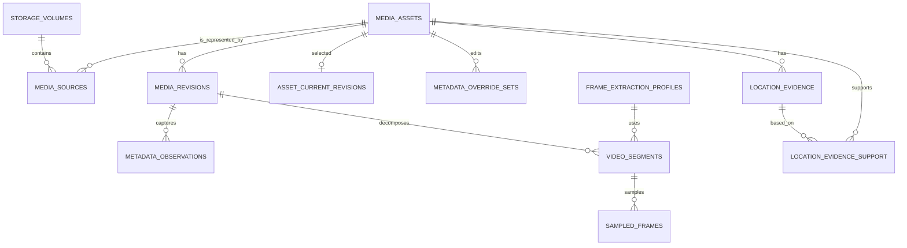
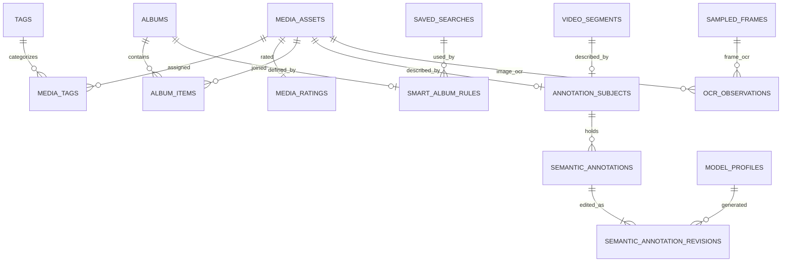
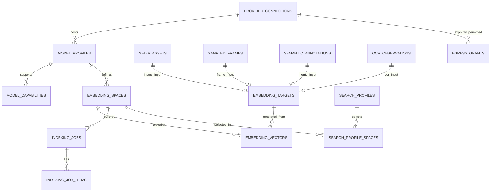
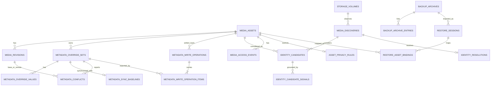

# Irohaco データモデル・ER図・第三正規形の検証仕様

- 文書ID: IRO-DB-001
- バージョン: 1.0.0
- 状態: 確定（初版、Room database version 1）。Roomの実装は`core/database`
- 作成日: 2026-10-18
- 確定日: 2026-10-19
- 対応PRD: `../PRD.md`
- 対応ARCH: `../ARCHITECTURE.md`
- DDL: [`schema.sql`](./schema.sql)（Room database version 1）
- 変更の条件: 基本テーブルを3NF未満にすることは禁止する。検索用のRead Modelでだけ冗長化を認め、そのときはADRを書く。

この文書でいう基本テーブルとは、派生データ（FTS、ANN、キャッシュなど）以外のテーブルを指す。

## 1. 保証する水準

データベースの基本テーブルはすべて第三正規形（3NF）以上にすることを必須の要件とする。

1. 1NF: 列には1つの意味を持つスカラー値を入れる。カンマ区切りのID、配列、JSONのリストで多対多を表さない。
2. 2NF: 非キー属性は、どの候補キーについても、その一部ではなく候補キー全体に完全関数従属させる。
3. 3NF: 非キー属性が別の非キー属性を経由してキーに推移的に従属する設計にしない。属性の関数従属性を定め、必要なら別の関係に分ける。
4. 例外の扱い: FTS、ANN、キャッシュ、集計のカウント、画面表示用のJOINの結果は派生の表で、基本テーブルではない。削除しても基本テーブルから作り直せるようにし、書き込む主体から独立させる。派生の構造が3NFでなくても、基本テーブルは3NFを保つ。
5. JSONとBLOBの制限: キーや外部キーで関連付けるべき構造化された属性やリストを、JSONのまま基本テーブルに保存しない。暗号化した外部APIキーもDBには保存しない。モデルの量子化されたバイナリやベクトルのBLOBは、分割して検索する業務上の属性ではないので、1つの変わらない値として扱う（ベクトル自体は派生データである）。
6. 変更の審査: 新しいテーブルと列には、候補キー、関数従属性、FK、一意制約、変更時に誰が更新するかを書く。新しいテーブルが3NFを満たすことはレビューで確かめる。SQLiteは正規形を自動では証明しない。

### 禁止する例と正規化の先

| 禁止する例（基本テーブルへの格納を禁止） | 理由 | 正規化の先 |
|---|---|---|
| `location_evidence.supporting_asset_ids = ['a','b']` | 値の繰り返しで、参照整合性がない | `location_evidence_support(evidence_id,supporting_asset_id)` |
| `media_assets.tags_json` | 多対多の埋め込み | `tags` + `media_tags` |
| `model_profiles.capability_json` | モデルと能力は1対多 | `model_capabilities` |
| `albums.items_json` | アルバムと写真は多対多 | `album_items` |
| `saved_searches.query_json`（構造化した条件を基本テーブルとして保存） | 繰り返しと階層が暗黙に埋め込まれる | `saved_search_roots` + `search_rule_nodes` + `search_rule_set_values` |
| `embedding_vectors.model_name, provider_url` | `space_id → model_profile_id → connection_id → base_url` という推移従属 | `embedding_spaces` → `model_profiles` → `provider_connections` |
| `sampled_frames.asset_id` を `segment_id` と並べて持つ | `segment_id → revision_id → asset_id` | 基本テーブルには `sampled_frames.segment_id` だけを持つ |
| `semantic_annotations.asset_id` を `segment_id` と並べて持つ | セグメントからassetが決まり、推移従属になる | `annotation_subjects`による排他的な参照 |
| `embedding_vectors.source_kind, source_id` の文字列による参照 | FKで実在を保証できない | `embedding_targets`の種類ごとのFK |

## 2. 論理ER図（機能別）

### 2.1 メディア・動画・メタデータ

`media_assets.asset_id` はアプリ内で変わらないが、`media_sources.content_uri` とMediaStoreのIDは変わることがある。`media_revisions.file_digest` と `visual_digest` は別の概念で、EXIFだけが変わって見た目が同じなら、Embeddingは作り直さない。推定した位置は元の画像のEXIFに書き込まず、`location_evidence` にためる。

### 2.2 管理・注釈

`annotation_subjects` は、assetとsegmentの**ちょうど一方**を参照する排他的なFKである。どの対象にも複数のメモを登録できる。動画に付けたメモが動画全体のものかシーンのものかは、参照先で区別する。

メモの本文は`semantic_annotation_revisions`に追記だけで保存し、`revision_no`が最大の行を現在の本文とする（本文を`semantic_annotations`に複製しない）。各revisionには作成者（USERかAI）を持たせ、AIが生成したものには生成元の`model_profile_id`を必須とする。

スマートアルバムは`smart_album_rules`で保存した検索を1つ参照して定義し、メンバーは検索結果から計算する（`album_items`に行を持たない）。手動のアルバムは反対に条件を持たない。

### 2.3 モデル・Embedding・索引・プライバシー

`embedding_targets`も**ちょうど1つ**のFKだけが非NULLになる。`embedding_vectors`は `space_id + target_id + source_revision_digest` の重複を禁止する。ベクトルはあとから上書きせず、別のrevisionとして追加する。検索では、選んだspaceと、参照元の現在のrevisionが一致するものだけを候補にする。

### 2.4 競合の解決・復元・アクセス・同一性の判定

メタデータの明示的な編集はタグごとの意図（`metadata_override_sets`）と、occurrenceごとの1つのスカラー値（`metadata_override_values`）に分ける。REMOVEは値が0件の集合で、REPLACEはoccurrenceが0以上の値で表し、操作の種類と値を同じ列に混ぜない。

原本への書き戻しのジャーナル`metadata_write_operations`は、どのタグの編集をどのlocal revisionで書いたかを`metadata_write_operation_items`に持つ。これで、`RECOVERY_REQUIRED`から再実行するときや検証するときの対象を特定できる。`before/after_revision_id`は複合FKで同じassetのrevisionだけを参照し、`COMMITTED`にするには書き込み後に読み込み直したrevision（`after_revision_id`）を必須とする。

## 3. 関数従属性（主なテーブル）

| 関係 | 候補キーと識別子 | 主な関数従属性 | 3NFにするための分け方 |
|---|---|---|---|
| `media_assets` | `asset_id` | `asset_id → media_kind, first_seen_at, tombstoned_at` | 物理ファイルの情報は持たない |
| `media_sources` | `source_id`、非NULLの`(volume_id,media_store_id)` | `source_id → asset_id, uri, name, mime, access_state,...` | ボリューム名は`storage_volumes`に持つ |
| `media_revisions` | `revision_id` | `revision_id → asset_id, file_digest, visual_digest, dimensions,...` | 現在のrevisionを指すポインタは別の関係にする |
| `video_segments` | `segment_id` | `segment_id → revision_id, extraction_profile_id, start_ms, end_ms` | `asset_id`を持たない |
| `sampled_frames` | `frame_id` | `frame_id → segment_id, timestamp_ms, frame_digest` | `asset_id`と`revision_id`を持たない |
| `semantic_annotations` | `annotation_id` | `annotation_id → subject_id, kind, searchable, exportable, created_at` | 親のassetの情報と現在の本文を繰り返さない |
| `semantic_annotation_revisions` | `(annotation_id,revision_no)` | キー → `author, model_profile_id, text, modified_at` | 履歴を行で持ち、現在の本文は最大のrevision |
| `smart_album_rules` | `album_id` | `album_id → saved_search_id` | 条件のJSONやメンバーの行を持たない |
| `location_evidence_support` | `(evidence_id,supporting_asset_id)` | 非キー属性はない | 根拠になったIDの配列を禁止する |
| `model_profiles` | `model_profile_id` | `model_profile_id → connection_id, provider_model_id,...` | 接続先のURLを重複して持たない |
| `model_capabilities` | `(model_profile_id,capability_code)` | 非キー属性はない | JSONの配列を禁止する |
| `embedding_spaces` | `space_id`、`space_signature` | `space_id → model_profile_id, dimension, normalization,...` | モデルの接続先は参照だけにする |
| `embedding_targets` | `target_id` | `target_id → {4つのFKのうち1つ}` | 型の決まらない文字列のFKを禁止する |
| `embedding_vectors` | `vector_id`、`(space_id,target_id,source_revision_digest)` | 各キー → `vector_blob,created_at` | `dimension`を重複して持たない |
| `egress_grants` | `(connection_id,task_code,payload_type)` | キー → `granted_at` | 送る内容の種類を配列で持たない |
| `search_profile_spaces` | `(search_profile_id,space_id)`、`(search_profile_id,priority)` | 各キー → そのほかの列 | プロファイルが使う複数の空間を関連の表に持つ |

### 3.1 競合の解決・識別・アクセス・バックアップの関数従属性

| 関係 | 候補キー | 非自明な関数従属性 | 3NFのための配慮 |
|---|---|---|---|
| `metadata_override_sets` | `override_id`, `(asset_id,namespace,tag_name)` | 候補キー → edit_mode,local_revision_no,modified_at | 繰り返す値は子テーブルに持つ |
| `metadata_override_values` | `(override_id,occurrence)` | キー → 1つの型の値 | 複数の値をJSONにしない |
| `metadata_sync_baselines` | `override_id` | キー → base_revision_id,base_local_revision_no,checked_at | asset IDは親からJOINで取る |
| `metadata_conflicts` | `conflict_id`, `(override_id,base_revision_id,remote_revision_id,observed_local_revision_no)` | キー → detected_at,resolution_code,resolved_at | asset IDの列を重複して持たない |
| `metadata_write_operations` | `operation_id` | キー → asset_id,before/after_revision_id,operation_state,backup_artifact_ref,requested_at | revisionは複合FKで同じassetのものを参照する |
| `metadata_write_operation_items` | `(operation_id,override_id)` | キー → written_local_revision_no | 書き込んだ内容を値の複製ではなく参照で記録する |
| `media_discoveries` | `discovery_id` | キー → volume,provider_media_store_id,uri,size,observed_at,state | Assetが決まる前の観測の記録 |
| `identity_candidates` | `(discovery_id,asset_id)` | キー → confidence,candidate_state | 根拠の種類は別の関係にする |
| `identity_candidate_signals` | `(discovery_id,asset_id,signal_code)` | キー → signal_digest | 複数の根拠を行として記録する |
| `identity_resolutions` | `discovery_id` | キー → resolution_kind,selected_asset_id,decided_by,resolved_at | ハッシュの一致だけでは決めない |
| `media_access_events` | `access_event_id` | キー → assetかsource、event_code,observed_at | assetとsourceの両方を持つことはCHECKで禁止する |
| `asset_privacy_rules` | `asset_id` | キー → allow_ai_indexing,allow_remote_send,updated_at | 個別の禁止は用途ごとの許可とは別にする |
| `backup_archives` | `backup_id` | キー → version,created_at,archive_ref,hash,encryption,state | 中に含まれる個々のレコードは別の関係にする |
| `backup_archive_entries` | `(backup_id,entity_kind,exported_entity_id)` | キー → content_sha256 | 正規化した中身の一覧 |
| `restore_sessions` | `restore_id` | キー → backup_id,state,started_at,completed_at | 失敗しても履歴を残す |
| `restore_asset_bindings` | `(restore_id,exported_asset_id)` | キー → local_asset_id,match_decision | あいまいな対応は状態として明示する |

### 3.2 注記: 列を細かくするだけでは3NFにならない

- 業務のルールに基づく関数従属性を先に決める。DBの `CHECK` とFKだけでは、3NFのすべてを自動では証明できない。
- 業務上のキーの候補を見落とすと、2NFや3NFを誤って判断することがある。上の表にない候補キーも、追加するときにレビューする。
- 複合キーの一部への依存が分かったら分解する。よく使うJOINを避けるために基本テーブルを非正規化することは認めない。
- 読み取りの最適化は`FTS projection`、`vector ANN projection`、DAOのProjection DTO、JOINのVIEWで行う。
- 他の表の非キー属性から機械的に求められる属性は複製しない。モデルやソースをまたぐ論理的な関数従属性は、業務のルールが決まるのに合わせてレビューし直す。SQLの制約のテストは3NFを証明しない。

## 4. 基本テーブルと派生インデックスの区別

| データ | 種類 | 復元の方法 |
|---|---|---|
| `media_assets`, `media_sources`, `media_revisions` | 基本テーブル（今アクセスできるメディアの観測情報） | MediaStoreなどから同期し直す。ただし変わらないasset_idとの対応は残す |
| タグ、評価、アルバム、セマンティックメモ、EXIFの上書き | 重要なユーザーデータ | アプリのDBのバックアップから復元する。自動で削除しない |
| `location_evidence`（推定を含む） | 推定の根拠のDB上の記録 | 根拠の種類を付けて復元するか、推定し直す |
| 元のEXIF | 画像ファイルの状態のスナップショット | 原本を読み込み直して観測する。ユーザーの上書きはoverrideとして別に保存する |
| `embedding_vectors` | 派生データ | 選んだモデル、入力のrevision、前処理から計算し直す |
| FTS / ANN / thumbnails / ranking cache | 派生のRead Model | 3NFの基本テーブルから作り直す。キャッシュを基本テーブルとして扱わない |
| `egress_grants` | ユーザーの許可の記録（基本テーブル） | バックアップから復元するときも、改めて認証と確認が必要 |

### 削除と外部キー

- 基本テーブルの関連は原則として `ON DELETE RESTRICT` にする。メディアが見つからなくなっただけでは、`asset_id`を削除しない。
- 端末の再スキャンでMediaStoreのIDが変わっても、既存の注釈と評価のFKは変わらない。
- 本当に恒久的に削除するのは、確認の画面、データの保存期間、バックアップ、EmbeddingのGCを備えた独立したUse Caseからだけにする。
- `foreign_keys=ON`を確実に有効にし、`PRAGMA foreign_key_check`で検証する。

## 5. インデックスと検索の整合性

1. カタログの更新は基本テーブルのDBトランザクションの中で確定し、影響を受けるターゲットをキューに登録する。
2. 画像と動画は見た目のRevisionを、メモとOCRはそれぞれのコンテンツのRevisionを、ソースの署名に使う。
3. モデルごとの`embedding_spaces`は変わらない署名を持ち、変えるときは新しいspaceを作る。
4. 新しいspaceは、BUILDINGとVERIFYINGの間は既存のREADYのspaceと並べて持ち、検証が終わったら`search_profile_spaces`の参照を1つのトランザクションで変える。
5. 検索では、選んだプロファイルに紐付くREADYのspaceだけを参照する。期限切れのベクトルと、アクセスできない写真は結果から除く。
6. RRFなどによる結果の統合は検索結果の一時的なデータで、メディアの基本テーブルにスコアを保存しない。
7. 差分同期の状態遷移と、障害を注入するテストは [`INDEX_STATE_MACHINE.md`](./INDEX_STATE_MACHINE.md) を参照する。

## 6. 追加の整合性条件（アプリ層とDB層）

| 不変条件 | どの層で守るか |
|---|---|
| フレームの時刻は親のセグメントの `[start_ms,end_ms)` の中にある（フレームとセグメントのどちらを更新しても） | SQLiteのtrigger（INSERT/UPDATE） |
| セグメントは動画のrevisionだけを参照する | SQLiteのtrigger（INSERT/UPDATE） |
| `asset_current_revisions`は同じassetのrevisionだけを指す | 複合FK |
| 書き戻しのジャーナルのrevisionと、対象のタグの編集は同じasset | 複合FK + SQLiteのtrigger |
| 手動のアルバムは条件を持たず、スマートアルバムはメンバーの行を持たない。種類の変更は空のときだけ | SQLiteのtrigger |
| タグ、アルバム、検索条件のノードは自分自身を親にしない | `CHECK` |
| 2段以上の親子の循環を作らない | Use Case（移動の操作で祖先を調べる）。SQLiteのトリガーでは再帰CTEを使えないため |
| メモの履歴は追記だけで、AIが生成したrevisionは生成元のモデルを持つ | `CHECK` + SQLiteのtrigger |
| 外部送信の許可とタスクの割り当てのタスクの種類は、定義した値だけ | `CHECK` |
| `annotation_subjects`はassetとsegmentのどちらか一方だけ | `CHECK` + FK |
| `embedding_targets`はasset、frame、annotation、OCRのどれか1つだけ | `CHECK` + FK |
| ベクトルのBLOBの長さは指定した次元の4倍（Float32 LE） | SQLiteのtrigger。正規化とNaNの検査は推論の境界で行う |
| 最初のインデックスのジョブはユーザーの操作で始める | `CHECK` + 画面とUse Case |
| 外部APIには、明示的に許可していない用途と内容を送らない | `egress_grants`に行がなければ拒否 + ネットワーク層での遮断 |
| スマートアルバムに物理的なメンバーの行を入れない | SQLiteのtrigger |
| メタデータの削除の指示と値の設定を混ぜない | SQLiteのtrigger（`metadata_override_sets.edit_mode`と`metadata_override_values`） |
| 検索条件のツリーは、保存した検索からのroot参照で始まり、ノードは親だけを持つ | `saved_search_roots` + FK + ASTの検証（循環、NOTの子の数） |
| SDカードを取り外してもユーザーのメタデータを失わない | RESTRICT + カタログの状態 + テスト |

## 7. DBが保証することとアプリ層が保証すること

| 性質 | DBが保証すること | Use Caseで保証すること |
|---|---|---|
| メタデータの複数の値 | occurrenceごとの1つの型と一意性 | タグ単位のトランザクション、REPLACEは1つ以上の要素を持つ |
| 競合 | 必須のFK、別のassetのrevisionを拒否する | 3-wayの比較、楽観ロック、原本の読み込み直し |
| 同一性 | SHAの一致だけによる自動のリンクを拒否する | ソースが連続しているかの実際の確認、あいまいなときのユーザーへの確認 |
| アクセス | イベントの参照整合性 | その時点のOSの許可、Uriを開けるか、結果からの除外 |
| バックアップ | manifest、entry、restoreのFKと状態 | 暗号化、署名の検証、パスの検査、容量の上限、ロールバック |
| エクスポート | ジャーナルのrevisionと対象のタグの編集は同じAssetで、COMMITTEDには書き込み後のrevisionが必須 | 書き込みの権限、file digestの確認、作業用コピーと書き込み後の検証 |
| 階層 | 自分自身を親にすることを禁止する | 2段以上の循環の検査 |

## 8. セキュリティ上の決まり

- `media_access_events`は監査の履歴としてだけ使う。端末の許可は永続的にキャッシュせず、毎回OSとContentResolverで確かめる。
- 画像へのアクセス権を失っても、注釈やアルバムのようなユーザーが作ったデータは自動では消さない。検索、表示、RAG、送信は止める。
- 外部に送るには、`egress_grants`に加えて、`asset_privacy_rules.allow_remote_send`と、実際にアクセスできることの両方を必須の条件とする。
- インポートで、APIの秘密情報、外部APIの許可、OSの権限を復元することは禁止する。
- AndroidのAuto Backupは、既定でユーザーデータをクラウドに保存することがあるので、`dataExtractionRules`と、古いAndroid向けの`fullBackupContent`を明示的に設定する。これは手動の暗号化アーカイブとは別のものである。

## 9. Roomへの移植の方針

- `schema.sql` は構造と制約を固定する参照用のDDLで、Room database version 1そのものとする。初版のリリース前には古いスキーマが存在しないので、移行の経路（`Migration`）は持たない。
- RoomのエンティティではCHECK制約とトリガーを表せない。そのため、アプリはエンティティからDBを作らない。初回の起動で`schema.sql`をそのまま実行してDBを作り、Roomには事前に用意したDB（`createFromFile`）として渡す。Roomは開くときに、すべてのエンティティを実際のテーブルと照合する（列、型、NOT NULL、主キー、外部キー、インデックス）。一致しなければDBを開かない。
- エンティティは`database/generate_room_entities.py`で`schema.sql`から生成し、手で編集しない。`schema.sql`を変えたら生成し直し、Roomのスキーマのエクスポート（`core/database/schemas/`）も一緒にコミットする。
- Roomのバージョンは2.8系、SQLiteのドライバーはAndroidに標準で入っているものを使う。`schema.sql`はminSdkのSQLite（3.32系）にある機能だけを使う。
- Roomは外部キーの検査を自動では有効にしないので、接続を開くたびに`PRAGMA foreign_keys=ON`を実行する。
- Roomはテーブルの定義の中に書いたUNIQUE制約を認識しない。外部キーの親として参照する列の組には、名前付きの`CREATE UNIQUE INDEX`を使う。
- `saved_search_roots`で保存した検索とツリーの根を結び、子のノードは`parent_node_id`だけを持つ。子に`search_id`を重複して保存すると、親から検索IDへの推移従属が生まれるので禁止する。
- `metadata_override_sets`のREMOVEは「行はあるが、対応する値が0件」として表し、上書きがない状態（行そのものがない）と区別する。操作の種類（edit_mode）と値を同じ列に混ぜない。
- `fallbackToDestructiveMigration` は使わない。リリース後にスキーマを変えるときは、その時点で、データを消さないMigrationと、失敗したときの復旧の手順を用意する。
- schema exportと、クラッシュからの再開のテストを必須とする。リリース後にスキーマを変更するときは、MigrationTestも必須にする。
- FTS5は使うドライバーとAndroidのSQLiteのバージョンで使えるかを確かめ、必要ならBundled SQLiteのドライバーかFTS4を使う。日本語の単語の分割と部分一致はFTS5を入れるだけでは解決しないので、形態素解析とN-gramの補助の索引の品質を実機で評価する。

## 10. 初期の実装で決める項目

- 長い動画の時間のチャンクごとの、フレームの密度と容量の上限と、分割して索引し直す方法（1本の動画のフレーム数に固定の上限は設けない。PRD §5.2）。
- 元のファイルが変わったかの判定（mtimeとサイズ、部分ハッシュ、完全なハッシュの組み合わせ）。
- 画面から検索のプロファイルを保存したりモデルを切り替えたりするときの、トランザクションの単位。
- 将来DBを分ける場合も含めたベクトルの格納の方式（SQLiteのBLOBから独立したベクトルの索引へ）。
- ContentResolverへの書き戻しとファイルの置き換えは、OS、メーカー、コンテナによって挙動が違う。安全に失敗できるかを実機でテストする。
- 同じファイルの移動、コピー、取り外しや、取り込みのIDが再利用されたときに、同一性をどう判断するか。
- バックアップの暗号化に使うライブラリ、KDFのパラメーター、攻撃への耐性。
- Androidの権限が取り消されたときに、ベクトルとOCRを保存し続けるか削除するかの詳しい規則と画面。
- 復元の途中でのプロセスの終了やディスク容量の不足を想定した、完全なトランザクションの設計。

どの項目も基本テーブルを3NF以上にするという要件をゆるめる理由にはならない。

## 11. 根拠資料

- SQLite 外部キー制約: https://sqlite.org/foreignkeys.html
- SQLite FTS5 外部コンテンツ: https://sqlite.org/fts5.html
- Android Room Entity: https://developer.android.com/training/data-storage/room/defining-data
- Android Room migrations: https://developer.android.com/training/data-storage/room/migrating-db-versions
- Android MediaStore getVersion/getGeneration: https://developer.android.com/reference/android/provider/MediaStore
