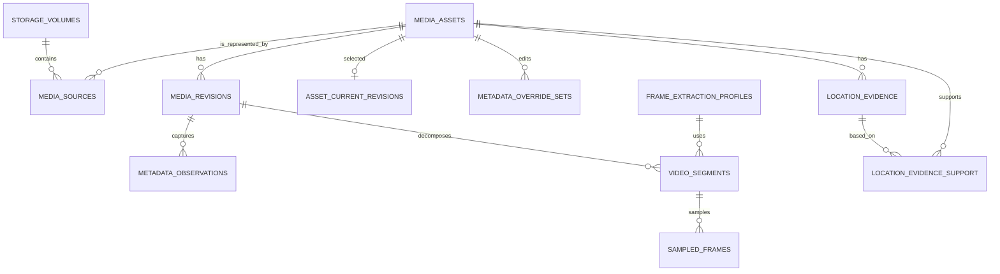
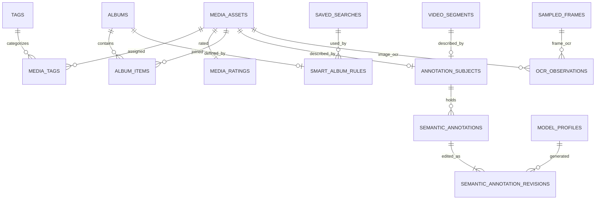
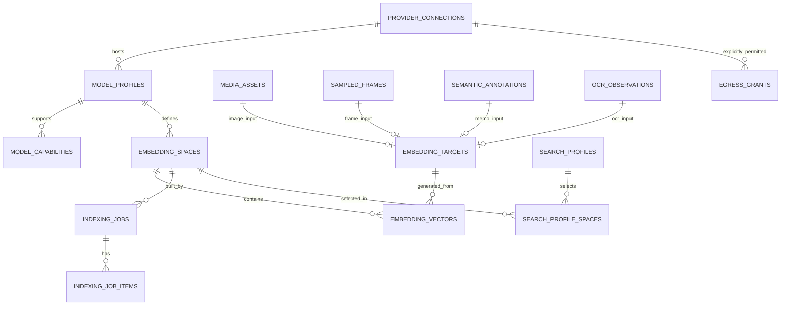
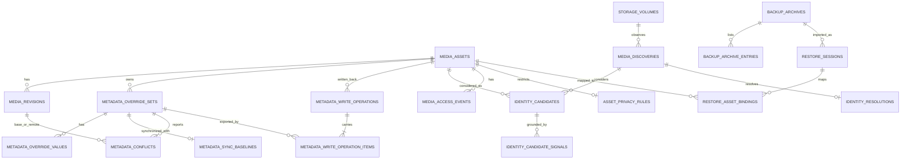

# Irohaco — データモデル・ER図・第三正規形の検証仕様

- 文書ID: IRO-DB-001
- バージョン: 1.0.0
- 状態: **確定**（初版 / Room database version 1）; Android Room実装は未着手
- 作成日: 2026-10-18
- 確定日: 2026-10-19
- 対応PRD: `../PRD.md`
- 対応ARCH: `../ARCHITECTURE.md`
- DDL: [`schema.sql`](./schema.sql)（Room database version 1）
- 変更条件: 正本スキーマの非3NF化は禁止。検索用Read Modelの冗長化のみ許可し、ADRを要する。

## 1. 保証水準

**正本データベースのすべての関係テーブルは、少なくとも第三正規形（3NF）を満たすことを必須要件とする。**

1. **1NF**: カラムは単一の意味のスカラー値を持つ。カンマ区切りID、配列、JSONリストで多対多を表現しない。
2. **2NF**: 非キー属性は、すべての候補キーの部分集合ではなく、候補キー全体に完全関数従属する。
3. **3NF**: 非キー属性が他の非キー属性を経由してキーに推移的に従属する設計を採らない。属性の関数従属性を定義し、必要なら別関係へ分割する。
4. **例外扱いの明確化**: FTS、ANN、キャッシュ、集計カウント、画面表示用JOIN結果は派生表であって正本ではない。削除後に正本から再構築可能にし、書込主体から独立させる。派生構造が3NFでない場合も**正本DBは3NFを維持**する。
5. **JSON/BLOBの制限**: キーや外部キーで関連付けるべき構造化属性・リストをJSONで正本保存しない。暗号化された外部APIキーそのものはDBへ保存しない。モデルの量子化バイナリやベクトルのBLOBは分割して検索する業務属性ではなく、一つの不変の値として管理する（ベクトル自体は派生データ）。
6. **変更審査**: すべての新テーブル・列に候補キー、関数従属性、FK、一意制約、変更時の更新責任を明記する。新テーブルはレビューで3NF充足を確認する。SQLiteは自動で正規形を証明しない。

### NG例と修正先

| NG（正本への格納を禁止） | 理由 | 正規化先 |
|---|---|---|
| `location_evidence.supporting_asset_ids = ['a','b']` | 反復値、参照整合性なし | `location_evidence_support(evidence_id,supporting_asset_id)` |
| `media_assets.tags_json` | M:Nの埋込み | `tags` + `media_tags` |
| `model_profiles.capability_json` | モデル:能力=1:N | `model_capabilities` |
| `albums.items_json` | アルバム:写真=M:N | `album_items` |
| `saved_searches.query_json`（構造化条件を正本として保存） | 反復・階層の暗黙埋込み | `saved_search_roots` + `search_rule_nodes` + `search_rule_set_values` |
| `embedding_vectors.model_name, provider_url` | `space_id → model_profile_id → connection_id → base_url` の推移従属 | `embedding_spaces` → `model_profiles` → `provider_connections` |
| `sampled_frames.asset_id` を `segment_id` と併記 | `segment_id → revision_id → asset_id` | `sampled_frames.segment_id` だけを正本で保持 |
| `semantic_annotations.asset_id` を `segment_id` と併記 | segment側からassetが確定し推移従属 | `annotation_subjects`で排他的参照 |
| `embedding_vectors.source_kind, source_id` の文字列参照 | FKで実在を保証できない | `embedding_targets`の型ごとのFK |

## 2. 論理ER図（機能別表示）

### 2.1 メディア・動画・メタデータ

重要: `media_assets.asset_id` はアプリ内で不変、`media_sources.content_uri` とMediaStore IDは変更され得る。`media_revisions.file_digest` と `visual_digest` は別概念。Exif-only変更でも視覚特徴が同じならEmbeddingを再生成しないようにする。推定位置は元画像のEXIFに書き込まず `location_evidence` へ蓄積する。

### 2.2 管理・注釈

`annotation_subjects` は asset または segment の **ちょうど一方**に参照する排他的FK。任意の対象に複数のメモを登録可能とする。動画に付加されたメモが「動画全体」か「シーン」かは参照先で区別する。

メモ本文は`semantic_annotation_revisions`に追記のみで保存し、最大`revision_no`の行を現行本文とする（本文を`semantic_annotations`へ複製しない）。各revisionに作成者（USER/AI）を持ち、AI生成なら生成元`model_profile_id`を必須とする。

スマートアルバムは`smart_album_rules`で保存検索を1つ参照して定義し、メンバーは検索結果から計算する（`album_items`に行を持たない）。手動アルバムは逆に条件を持たない。

### 2.3 モデル・Embedding・索引・プライバシー

`embedding_targets`も**ちょうど一つ**のFKが非NULLとなる。`embedding_vectors`は `space_id + target_id + source_revision_digest` で重複を禁止する。ベクトルは後から上書きせず別revisionとして挿入する。検索時には選択spaceと参照元の現行revisionが一致するものだけを有効候補にする。

### 2.4 競合解決・復元・アクセス・同一性判定

メタデータの明示編集は「タグ単位の意図（`metadata_override_sets`）」と「occurrenceごとの単一スカラー値（`metadata_override_values`）」に分離する。REMOVEは値ゼロの集合、REPLACEはoccurrence 0以上の値で表現し、操作種別と値を同じ列に混在させない。

原本への書き戻しジャーナル`metadata_write_operations`は、どのタグ編集をどのlocal revisionで書いたかを`metadata_write_operation_items`に持つ。これにより`RECOVERY_REQUIRED`からの再実行・検証対象を特定できる。`before/after_revision_id`は同一assetのrevisionだけを複合FKで参照し、`COMMITTED`には書込後の再読込revision（`after_revision_id`）を必須とする。

## 3. 関数従属性（主要テーブル）

| 関係 | 候補キー・識別子 | 主な関数従属性 | 分割による3NF対策 |
|---|---|---|---|
| `media_assets` | `asset_id` | `asset_id → media_kind, first_seen_at, tombstoned_at` | 物理ファイル情報を格納しない |
| `media_sources` | `source_id`、非NULLの`(volume_id,media_store_id)` | `source_id → asset_id, uri, name, mime, access_state,...` | volume名は`storage_volumes` |
| `media_revisions` | `revision_id` | `revision_id → asset_id, file_digest, visual_digest, dimensions,...` | 現行revポインタは別関係 |
| `video_segments` | `segment_id` | `segment_id → revision_id, extraction_profile_id, start_ms, end_ms` | `asset_id`を持たない |
| `sampled_frames` | `frame_id` | `frame_id → segment_id, timestamp_ms, frame_digest` | `asset_id`,`revision_id`を持たない |
| `semantic_annotations` | `annotation_id` | `annotation_id → subject_id, kind, searchable, exportable, created_at` | 親のasset情報・現行本文を繰り返さない |
| `semantic_annotation_revisions` | `(annotation_id,revision_no)` | キー → `author, model_profile_id, text, modified_at` | 履歴を行で保持、現行は最大revision |
| `smart_album_rules` | `album_id` | `album_id → saved_search_id` | 条件JSONやメンバー行を持たない |
| `location_evidence_support` | `(evidence_id,supporting_asset_id)` | 非キー属性なし | 支持元ID配列を禁止 |
| `model_profiles` | `model_profile_id` | `model_profile_id → connection_id, provider_model_id,...` | 接続先URLを重複させない |
| `model_capabilities` | `(model_profile_id,capability_code)` | 非キー属性なし | JSON配列を禁止 |
| `embedding_spaces` | `space_id`、`space_signature` | `space_id → model_profile_id, dimension, normalization,...` | モデル接続先は参照のみ |
| `embedding_targets` | `target_id` | `target_id → {4 FKのいずれか1つ}` | ポリモーフィックな裸文字列FKを禁止 |
| `embedding_vectors` | `vector_id`、`(space_id,target_id,source_revision_digest)` | 各キー → `vector_blob,created_at` | `dimension`を重複して持たない |
| `egress_grants` | `(connection_id,task_code,payload_type)` | キー → `granted_at` | 1:Nペイロード配列を禁止 |
| `search_profile_spaces` | `(search_profile_id,space_id)`、`(search_profile_id,priority)` | 各キー → その他の列 | プロファイル上の複数空間を関連表へ |

### 3.1 競合解決・識別・アクセス・バックアップの関数従属性

| 関係 | 候補キー | 非自明な関数従属性 | 3NF上の配慮 |
|---|---|---|---|
| `metadata_override_sets` | `override_id`, `(asset_id,namespace,tag_name)` | 候補キー→edit_mode,local_revision_no,modified_at | 繰返し値は子テーブルへ |
| `metadata_override_values` | `(override_id,occurrence)` | キー→単一型の値 | 多値情報をJSONにしない |
| `metadata_sync_baselines` | `override_id` | キー→base_revision_id,base_local_revision_no,checked_at | asset IDは親からJOINで取得 |
| `metadata_conflicts` | `conflict_id`, `(override_id,base_revision_id,remote_revision_id,observed_local_revision_no)` | キー→detected_at,resolution_code,resolved_at | asset IDの重複列なし |
| `metadata_write_operations` | `operation_id` | キー→asset_id,before/after_revision_id,operation_state,backup_artifact_ref,requested_at | revisionは同一assetを複合FKで参照 |
| `metadata_write_operation_items` | `(operation_id,override_id)` | キー→written_local_revision_no | 書込内容を値の複製でなく参照で記録 |
| `media_discoveries` | `discovery_id` | キー→volume,provider_media_store_id,uri,size,observed_at,state | Asset確定前の観測記録 |
| `identity_candidates` | `(discovery_id,asset_id)` | キー→confidence,candidate_state | 根拠種別は別relation |
| `identity_candidate_signals` | `(discovery_id,asset_id,signal_code)` | キー→signal_digest | 複数シグナルを行として記録 |
| `identity_resolutions` | `discovery_id` | キー→resolution_kind,selected_asset_id,decided_by,resolved_at | ハッシュ一致で決定しない |
| `media_access_events` | `access_event_id` | キー→assetまたはsource、event_code,observed_at | asset/source両方保存をCHECKで禁止 |
| `asset_privacy_rules` | `asset_id` | キー→allow_ai_indexing,allow_remote_send,updated_at | 個別禁止は用途許可とは別 |
| `backup_archives` | `backup_id` | キー→version,created_at,archive_ref,hash,encryption,state | 中身の個別レコードは別relation |
| `backup_archive_entries` | `(backup_id,entity_kind,exported_entity_id)` | キー→content_sha256 | 正規化されたinventory |
| `restore_sessions` | `restore_id` | キー→backup_id,state,started_at,completed_at | 失敗時も履歴を保持 |
| `restore_asset_bindings` | `(restore_id,exported_asset_id)` | キー→local_asset_id,match_decision | 曖昧マッピングは明示的状態 |

### 3.2 注記: 3NFは「列を細かくすれば達成」ではない

- 業務ルールに基づく関数従属性が先。DBの `CHECK`/FKだけでは全ての3NFを自動証明できない。
- ビジネスキー候補を見落とすと2NF/3NFを誤判定する可能性がある。上記以外の候補キーも追加時にレビューする。
- 複合キーや部分キー依存が分かれば分解する。高頻度JOINを避けるため正本を非正規化することは**許可しない**。
- 読取り最適化は `FTS projection`、`vector ANN projection`、DAO Projection DTO、JOIN VIEWで行う。
- 他表の非キー属性から機械的に復元できる属性を複製しない。モデル・ソースを跨ぐ論理関数従属性は業務ルールの確定に合わせて再レビューする。SQLの制約テストは3NFを証明しない。

## 4. 正本と派生インデックスの境界

| データ | 正本か | 復元方法 |
|---|---|---|
| `media_assets`, `media_sources`, `media_revisions` | 正本（現在アクセス可能な媒体の観測情報） | MediaStore等から再同期。ただし不変asset_idとの対応は保持 |
| タグ、評価、アルバム、セマンティックメモ、EXIFオーバーライド | **重要なユーザーデータ** | アプリDBバックアップから復元。自動削除しない |
| `location_evidence`（推定含む） | 推定根拠のDB記録 | 根拠種別を付して復元/再推論 |
| 元のEXIF | 画像ファイル側の状態スナップショット | 原本再読込で観測。ユーザー上書きはoverrideとして別保存 |
| `embedding_vectors` | 派生データ | 選択したモデル＋入力rev＋前処理から再計算 |
| FTS / ANN / thumbnails / ranking cache | **派生Read Model** | 3NF正本から再生成。キャッシュを正本としない |
| `egress_grants` | ユーザー許可の正本 | バックアップから復元する場合も別途再認証・確認が必要 |

### 削除と外部キー

- 正本関連は原則 `ON DELETE RESTRICT`。媒体が行方不明になっただけでは`asset_id`を削除しない。
- 端末再スキャンでMediaStore IDが変わっても、既存注釈・評価のFKは不変。
- 真の恒久削除は、確認UI・データ保存期間・バックアップ・Embedding GCを持つ独立Use Caseから実行。
- `foreign_keys=ON`を確実に有効化し、`PRAGMA foreign_key_check`で検証する。

## 5. インデックスと検索の整合性

1. カタログ更新は正本DBトランザクション内で確定し、影響するターゲットをキューに登録する。
2. 画像/動画は **視覚Revision** を、メモ/OCRはそれぞれのコンテンツRevisionをソース署名に使用する。
3. モデル別の`embedding_spaces`は不変署名を持つ。変更は新しいspaceを作る。
4. 新spaceはBUILDING/VERIFYING中は既存のREADY spaceと併存し、検証完了後に`search_profile_spaces`の参照を1トランザクションで変更する。
5. 検索は選択プロファイルに紐づくREADY spaceだけを参照する。期限切れベクトルとアクセスできない写真は結果から除外する。
6. RRFなどの結果統合は検索結果の一時データであり、メディア正本へスコアを保存しない。
7. 差分同期の状態遷移と障害注入テストは [`INDEX_STATE_MACHINE.md`](./INDEX_STATE_MACHINE.md) を参照。

## 6. 追加の整合性条件（アプリ層とDB層）

| 不変条件 | 担保層 |
|---|---|
| フレーム時刻は親セグメント `[start_ms,end_ms)` 内（フレーム側・セグメント側どちらのUPDATEでも） | SQLite trigger（INSERT/UPDATE） |
| セグメントは動画のrevisionのみを参照 | SQLite trigger（INSERT/UPDATE） |
| `asset_current_revisions`は同一assetのrevisionだけを指す | composite FK |
| 書き戻しジャーナルのrevisionと対象タグ編集は同一asset | composite FK + SQLite trigger |
| 手動アルバムは条件を持たず、スマートアルバムはメンバー行を持たない。種別変更は空の場合のみ | SQLite trigger |
| タグ・アルバム・検索条件ノードは自分自身を親にしない | `CHECK` |
| 2段以上の親子循環を作らない | Use Case（移動操作時に祖先を検査）。SQLiteのトリガーでは再帰CTEを使えないため |
| メモ履歴は追記のみ、AI生成revisionは生成元モデルを持つ | `CHECK` + SQLite trigger |
| 外部送信許可・タスク割当のタスク種別は定義済みの値のみ | `CHECK` |
| `annotation_subjects`はasset/segmentいずれか一方のみ | `CHECK` + FK |
| `embedding_targets`はasset/frame/annotation/OCRのいずれか一方のみ | `CHECK` + FK |
| vector BLOB長は4×指定dim（Float32 LE） | SQLite trigger; 正規化・NaN検査は推論境界 |
| index初回ジョブはユーザー操作を伴う | `CHECK` + UI/use case |
| 外部APIは明示許可されていない用途・ペイロードを送信しない | `egress_grants`行が存在しない場合DENY + ネットワークゲート |
| スマートアルバムに物理メンバー行を入れない | SQLite trigger |
| メタデータ削除指示と値SETを混在させない | SQLite trigger（`metadata_override_sets.edit_mode`と`metadata_override_values`） |
| 検索条件ツリーは保存検索からroot参照で始まり、nodeは親だけを保持 | `saved_search_roots` + FK + AST検証（循環/NOT子数） |
| SDカード取り外しでユーザーメタデータ消失なし | RESTRICT + catalog state + tests |

## 7. DBによる保証とアプリ層の保証

| 性質 | DBが保証すること | Use Caseで保証すること |
|---|---|---|
| メタデータ多値 | occurrenceごとの単一型・一意性 | タグ単位トランザクション、REPLACEが最低1要素 |
| 競合 | 必須FK、asset違いのrevisionを拒否 | 3-way比較、楽観ロック、原本再読込 |
| identity | SHA一致のみの自動リンクを拒否 | ソース連続性の実確認、曖昧時ユーザー確認 |
| access | イベントの参照整合性 | OSライブ許可、Uri開封、結果からの除外 |
| backup | manifest/entry/restoreのFKと状態 | 暗号化・署名検証・パス検査・容量上限・ロールバック |
| export | journalのrevision・対象タグ編集は同じAsset、COMMITTEDは書込後revision必須 | 書込権限、file digest確認、ステージング＆post-verify |
| 階層 | 自己参照の禁止 | 2段以上の循環検査 |

## 8. セキュリティ上の取り決め

- `media_access_events`は監査履歴だけ。端末許可は永続キャッシュせず毎回OSとContentResolverを確認。
- 画像のアクセス権を失っても注釈・アルバムなどの**ユーザー作成正本は自動消去しない**。検索・表示・RAG・送信は止める。
- `egress_grants`に加え、`asset_privacy_rules.allow_remote_send`と**実際のアクセス可否**の両方を必須条件とする。
- インポートでAPI秘密情報、外部API許可、OS権限を復元することを禁止。
- Android Auto Backupは既定でユーザーデータをクラウドへ保存し得るため、`dataExtractionRules`と旧Android用`fullBackupContent`を明示設定。手動暗号化アーカイブとは別物。

## 9. Room移植の方針

- `schema.sql` は構造・制約を固定する**参照DDL**で、Room database version 1そのものとする。初版リリース前に旧スキーマは存在しないため、移行経路（`Migration`）は持たない。プロダクションはKotlin Room Entity / DAOで等価なテーブルを作成し、Roomが生成するスキーマJSONをCIでdiff検証する。
- `PRAGMA foreign_keys=ON`、FK索引、UNIQUE、CHECK、部分UNIQUE、トリガーの同等性を検証する。Roomアノテーション単独で表現できない制約・トリガーは`RoomDatabase.Callback.onCreate`で追加する。
- `saved_search_roots`で保存検索とツリー根を結び、子ノードは`parent_node_id`だけを保持する。子に`search_id`を重複保存すると親→検索IDの推移従属を生むため禁止。
- `metadata_override_sets`のREMOVEは『行は存在するが対応する値が0件』として表し、オーバーライド無し（行自体が存在しない）と区別する。操作種別（edit_mode）と値を同じ列に混在させない。
- `fallbackToDestructiveMigration` は **厳禁**。リリース後にスキーマを変更する場合は、その時点で非破壊Migrationと失敗時の復旧フローを用意する。
- schema exportとクラッシュ再開テストを必須とする。MigrationTestはversion 2以降を作る時点から必須。
- FTS5は利用ドライバー/Android SQLiteバージョンで利用可能性を確認し、必要ならBundled SQLiteドライバーまたはFTS4を使う。**日本語の単語分割・部分一致はFTS5導入だけでは解決しない**ため、形態素解析・N-gram補助索引の品質を実機評価する。

## 10. 初期実装でまだ決める項目

- Roomバージョンと同梱SQLiteドライバー方式。
- 動画単位のフレーム数上限および長時間動画をどう分割して再索引するか。
- sourceファイル変更の判定（mtime/size・部分hash・完全hashの組み合わせ）。
- UIからの検索プロファイル保存・モデル切替のトランザクション単位。
- 将来の分割DBを含むベクトル格納戦略（SQLite BLOB→独立ベクトル索引）。
- ContentResolverへの書き戻し/ファイル置換はOS・メーカー・コンテナによって挙動が異なる。安全に失敗できるか実機テスト必須。
- 同じファイルの移動/コピー/取り外し、取り込みIDが再利用されたときのidentification policy。
- バックアップ暗号化方式の依存ライブラリ・KDFパラメータと攻撃耐性。
- Android権限取り消しによるベクトル/OCRの保存継続と削除規則の詳細・UI。
- RESTORE中のプロセス死亡・ディスク容量不足を想定した完全トランザクション設計。

いずれも **「少なくとも3NF」** という正本スキーマの要件を緩める理由にはならない。

## 11. 根拠資料

- SQLite 外部キー制約: https://sqlite.org/foreignkeys.html
- SQLite FTS5 外部コンテンツ: https://sqlite.org/fts5.html
- Android Room Entity: https://developer.android.com/training/data-storage/room/defining-data
- Android Room migrations: https://developer.android.com/training/data-storage/room/migrating-db-versions
- Android MediaStore getVersion/getGeneration: https://developer.android.com/reference/android/provider/MediaStore
