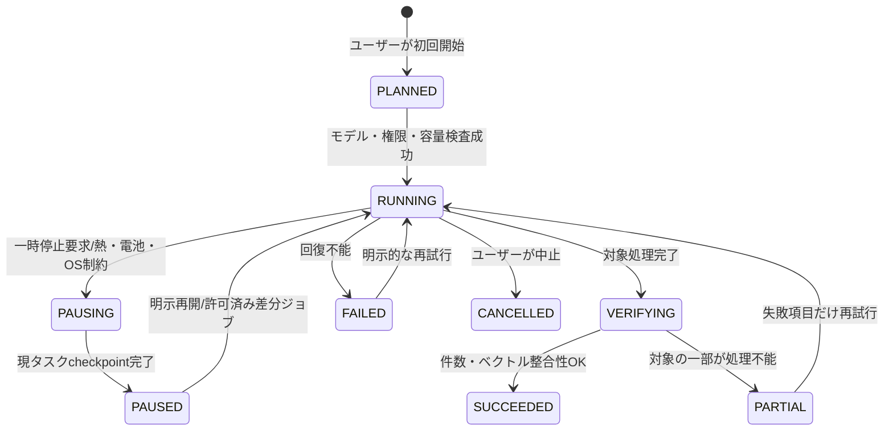
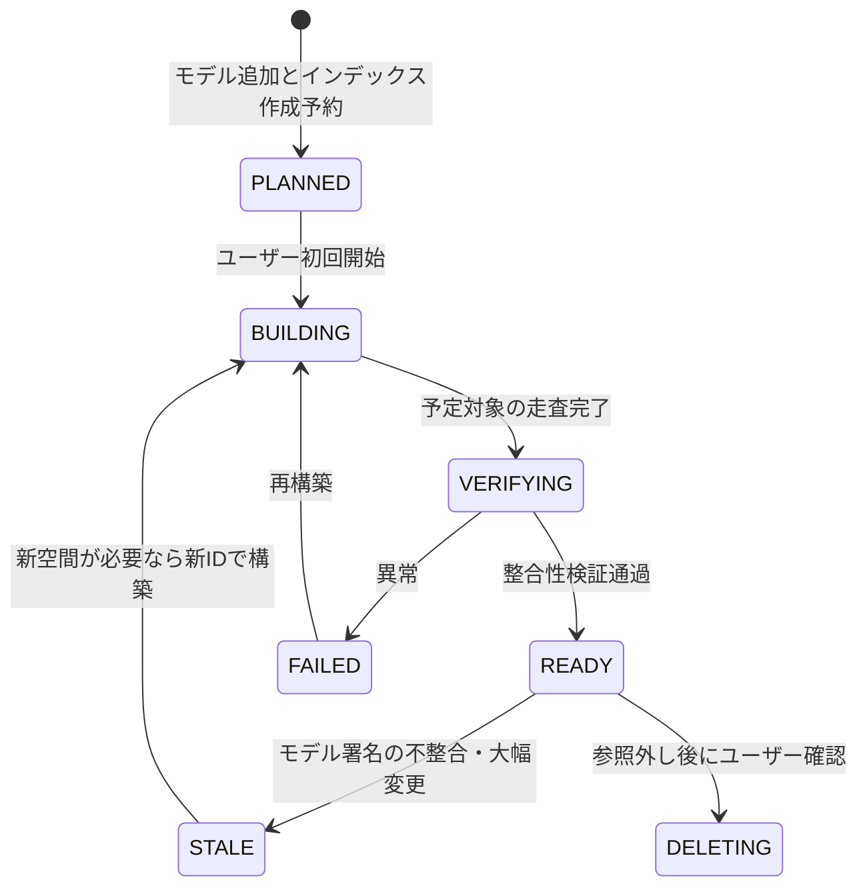
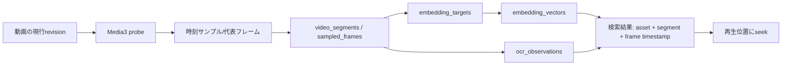

# Irohaco カタログ同期・Embeddingインデックス状態遷移仕様

- 文書ID: IRO-IDX-001
- 日付: 2026-10-18
- 前提: 基本テーブルは3NF以上、モデルごとに独立した索引、初期リリースから動画に対応、最初のAI索引はユーザーの操作で始める。

## 1. 概要

カタログはAIがなくても常に使える。Embeddingは派生のキャッシュなので、使えなくても検索が限られるだけで、写真とメタデータには影響しない。



`indexing_jobs.state`はジョブの実行状態、`embedding_spaces.lifecycle_state`は選べるベクトル空間の状態を表す。ジョブがSUCCEEDEDでも、対象の範囲が限られているときはカバレッジを表示し、全体がREADYであるかのように見せない。

## 2. 空間の状態



`STALE -> BUILDING`は、同じIDの空間の設定を変えることではない。モデルか前処理が変わったら、別の空間を新しく作る。

## 3. 検索時のモデルの切り替え（まとめて切り替える）

```text
旧space A = READY / 新space B = BUILDING
    ↓
Bのジョブを検証 / 旧Aで検索を継続
    ↓
B = READY を確定
    ↓
BEGIN IMMEDIATE;
    search_profile_spacesの参照を A から B へ更新
COMMIT;
    ↓
新規検索はBで実行。既に開始した検索は選択済みspaceのスナップショットに従う。
    ↓
旧Aは保持可能。明示削除までGCしない。
```

ユーザーがモデルを明示的に選ぶだけなら、`search_profile_spaces`を変える必要もなく、検索リクエストで選ぶspaceのIDを変えればよい。DBに保存するのは、既定のプロファイルを更新したときだけとする。

## 4. 生成ジョブの冪等性

自然キーは`(job_id, target_id, source_revision_digest)`で、同じ入力を再試行しても重複して追加しない。結果の側も`(space_id,target_id,source_revision_digest)`で一意にする。

1. `indexing_job_items.state=PENDING`の項目を取得する。
2. バックグラウンドの処理に移してRUNNINGにし、その項目の再試行の回数を増やす。
3. デコード、OCR、EmbeddingはDBトランザクションの外で実行し、画面を止めない。
4. 生成した結果の`space_id`、ターゲット、ソースのrevisionが、開始したときと同じかを確かめ直す。
5. `BEGIN`、ベクトルの挿入（`UNIQUE`で重複したら既存の結果を使う）、項目をCOMMITTEDにする、`COMMIT`の順に行う。
6. OSによる停止やクラッシュのあとは、`RUNNING`の項目を復旧のキューに戻して再実行する。
7. `source_revision_digest`が変わっていたら、古い結果は検索の対象から外し、新しいrevisionで作り直す。既存のREADYの空間での検索は止めない。

### 初回の実行の制約（例外なし）

初回のジョブ（`job_kind=INITIAL`）には`requested_by_user=1`が必要である。ユーザーがインデックスを開始していなければ、カタログの同期だけを行う。モデルをダウンロードしただけで、全部の写真の推論を始めることはしない。

## 5. 動画のパイプライン



- 映像のソースのrevisionは動画の映像データと抽出のプロファイルで決まる。EXIFが変わっただけでは抽出し直さない。
- `video_segments`の時刻の範囲は`[start_ms,end_ms)`で、フレームはその範囲の中にある。
- シーンの変化の推定には誤差がある。短い場面を取りこぼすことは、カバレッジの表示と、細かく索引し直す操作への案内で説明する。
- 動画の検索画面には一致したシーンのサムネイルとタイムスタンプを表示し、タップしたらその位置へシークする。

## 6. 変更のイベントと無効化のルール

| 変更のイベント | 読み込み直し | 画像のEmbedding | 文字のEmbedding | 位置の検索 | ユーザーのメタデータ |
|---|---|---|---|---|---|
| 新しい画像 | MediaStoreに追加 | 新しく作る | OCRが有効なら作る | EXIFを観測 | 変更なし |
| 新しい動画 | MediaStoreに追加 | フレームを抽出して作る | フレームのOCR | EXIFを観測 | 変更なし |
| 写真のピクセルの編集 | revisionを更新 | 影響する画像だけ作り直す | OCRに影響があれば作り直す | 必要なら見直す | 残す |
| 動画のトリムや差し替え | revisionを更新 | 影響する区間を抽出し直す | 該当するフレームのOCR | 必要なら見直す | 動画単位のメモは残し、シーンのメモは対応付けし直す |
| EXIFのGPSの追加、編集、削除 | metadata overrideを更新 | 残す | GPSから作った文だけ作り直す | 検索し直す対象にする | 残す |
| 日時の補正 | overrideを更新 | 残す | 原則として残す | 時間から推定したものを評価し直す | 残す |
| メモの追加、変更、削除 | annotationのrevisionを更新 | 残す | 対象だけ作るか無効にする | メモから推定したものなら評価し直す | 残す |
| Embeddingモデルの追加 | spaceを作る | 新しいspaceに必要な対象だけ | 新しいspaceに必要な対象だけ | 残す | 残す |
| モデルの切り替え | 画面とSearchProfileだけ | 何も作り直さない（READYなら） | 同左 | 残す | 残す |
| SDカードの抜去 | access_stateをOFFLINEにする | 消さない | 消さない | 消さない | 残す |
| 部分的なアクセス権の取り消し | INACCESSIBLE | 残すが結果から除く | 残すが結果から除く | 残すが結果から除く | 残す |
| 確認済みの実際の削除 | tombstone | GCの候補 | GCの候補 | 参照の履歴を残すかの方針に従う | すぐには自動で削除しない |

## 7. クラッシュ時の整合性と原本の保護

- メタデータを原本に反映するときの状態は `REQUESTED → PERMISSION_PENDING → STAGED → WRITE_PENDING → VERIFYING → COMMITTED` と進む。中断したときと内容が一致しないときは`RECOVERY_REQUIRED`にする。
- ファイルを変えるときは、できるかぎり安全な作業用コピーに書き込み、検証してから置き換える。MediaStoreやSAFのプロバイダーによっては本当のatomic renameを保証できないので、「いつもアトミックに置き換えられる」とは言わない。
- DBのコミットと、原本のファイルへの書き込みは別のトランザクションである。`metadata_write_operations`を冪等なジャーナルとして使い、起動時に復旧の処理を行う。
- EXIFのGPSとAIが推定した位置は別の根拠である。自動の補完で原本に書き込まない。

## 8. テストケース（必要な条件）

| ID | ケース | 合格の条件 |
|---|---|---|
| IST-001 | 最初のAI索引を開始しない | MediaStoreの写真の一覧だけを使え、推論は始まっていない |
| IST-002 | 1000件を処理している途中でプロセスを強制終了する | 再開したあと重複がなく、処理済みのベクトルが残っている |
| IST-003 | 作成中のBへの切り替えを求める | BをREADYとして扱わず、Aを使える状態にしておく |
| IST-004 | AとBがどちらもREADY | 検索画面ですぐに切り替わり、古いAを削除しない |
| IST-005 | EXIFの位置を変える | 画像のベクトルを作り直さず、位置の検索に反映する |
| IST-006 | 動画の10秒の地点に一致する | 一致したシーンの再生時刻の情報を返す |
| IST-007 | SDカードを抜く | 注釈、タグ、検索の履歴を失わず、OFFLINEと表示する |
| IST-008 | 一部の写真の権限を取り消す | 許可されていない画像の内容を、画面にも外部APIにも出さない |
| IST-009 | 外部APIが許可されていない | 生成でもEmbeddingでも、画像をネットワークに送らない |
| IST-010 | AIの失敗やモデルの破損 | 基本のギャラリーは動き続ける |
| IST-011 | 原本へのメタデータの反映中にクラッシュする | ジャーナルにRECOVERY_REQUIREDを残し、二重に書き込まない |
| IST-012 | 動画で短い時間にシーンが変わる | カバレッジの制約を説明し、細かく索引し直せる |
