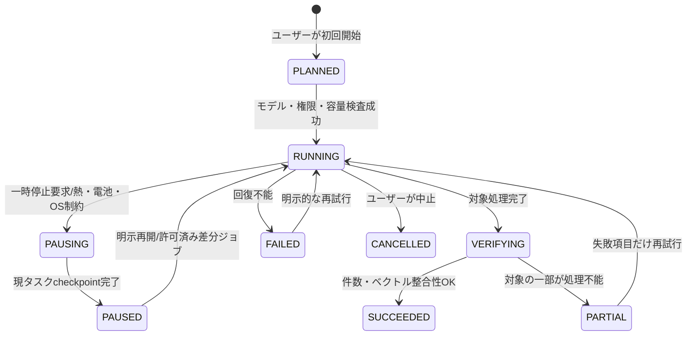
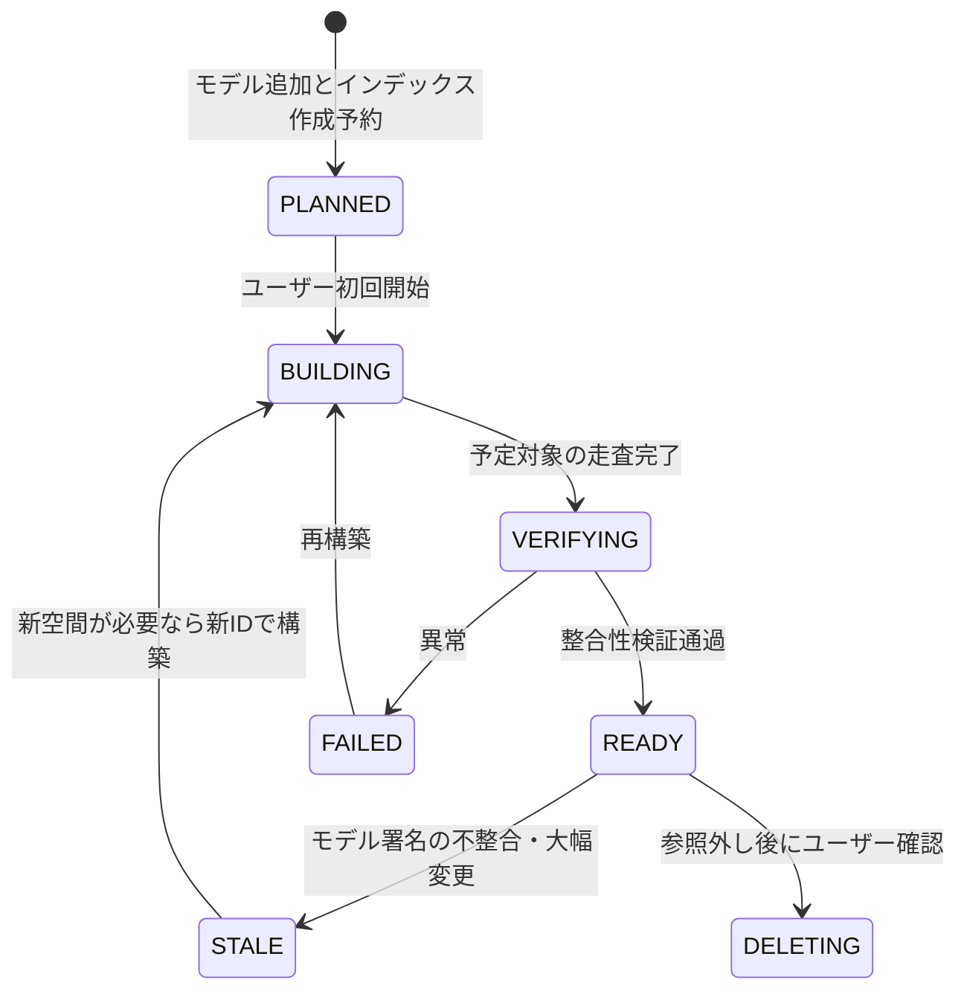
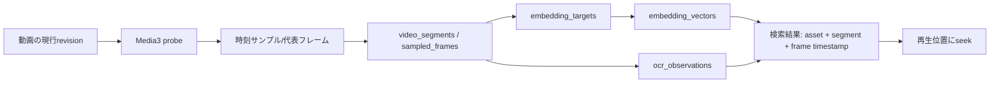

# Irohaco — カタログ同期・Embeddingインデックス状態遷移仕様

- 文書ID: IRO-IDX-001
- 日付: 2026-10-18
- 前提: 正本DBは3NF以上、モデル別独立索引、動画初期対応、初回AI索引はユーザー操作。

## 1. 概要

**catalogはAIなしで常時利用できる。embeddingは派生キャッシュであり、利用不能なら検索が限定されるだけで、写真・メタデータは壊れない。**



`indexing_jobs.state` = ジョブ実行状態、`embedding_spaces.lifecycle_state` = 選択可能なベクトル空間の状態。**ジョブがSUCCEEDEDでも、対象範囲が限定される場合はカバレッジを表示し、全面的なREADYと混同しない。**

## 2. Space状態



注意: `STALE -> BUILDING`は同じIDの設定を変更することではない。モデルまたは前処理が変われば**別Spaceを新規作成**する。

## 3. 検索時モデル切替（原子的な切替）

```text
旧space A = READY / 新space B = BUILDING
    ↓
Bのジョブを検証 / 旧Aで検索を継続
    ↓
B = READY を確定
    ↓
BEGIN IMMEDIATE;
    search_profile_spacesの参照を A から B へ更新
COMMIT;
    ↓
新規検索はBで実行。既に開始した検索は選択済みspaceのスナップショットに従う。
    ↓
旧Aは保持可能。明示削除までGCしない。
```

モデルの明示選択だけなら `search_profile_spaces` 変更すら不要で、検索リクエストの選択space IDを切り替えればよい。デフォルトプロファイル更新だけをDBへ保存する。

## 4. 生成ジョブの冪等性

自然キー: `(job_id, target_id, source_revision_digest)`。同じ入力をリトライしても重複追加しない。結果側も `(space_id,target_id,source_revision_digest)` で一意。

1. `indexing_job_items.state=PENDING` のアイテムを取得。
2. バックグラウンド処理へ移動しRUNNINGへ遷移、個別タスクのretry数増加。
3. Decode/OCR/EmbeddingはDBトランザクションの**外**で実行し、UIブロックしない。
4. 生成結果の`space_id`、ターゲット、ソースrevisionが開始時のものと一致するか再検証。
5. `BEGIN` → ベクトル挿入 (`UNIQUE`は重複なら結果を再利用) → アイテムをCOMMITTED → `COMMIT`。
6. OS停止・クラッシュ後は`RUNNING`アイテムを復旧キューに戻して再実行。
7. `source_revision_digest` が変わっていたら古い結果は検索対象から外し、新revisionを投入。既存のREADY検索を壊さない。

### 初回実行に関する例外なしの制約

初回ジョブ `job_kind=INITIAL` には `requested_by_user=1` が必要。ユーザーがインデックスを開始していなければ、カタログ同期のみを行う。モデルをダウンロードしただけで全写真の推論を始めない。

## 5. 動画パイプライン



- 視覚ソースrevisionは動画の映像データ/抽出プロファイルに依存し、EXIFの変更だけで無条件に再抽出しない。
- `video_segments` の時刻範囲は `[start_ms,end_ms)`、フレームはその範囲内にある。
- シーン変更推定は誤差を持つ。短い場面の取りこぼしはカバレッジ表示と精密再インデックス導線で説明。
- 動画の検索UIは一致シーンのサムネイルとタイムスタンプを表示し、タップでseekする。

## 6. 変更イベント→無効化ルール

| 変更イベント | 再読み込み | 視覚Embedding | 文字Embedding | 位置検索 | ユーザーメタデータ |
|---|---|---|---|---|---|
| 新画像 | MediaStore追加 | 新規投入 | OCRが有効なら投入 | EXIF観測 | 変更なし |
| 新動画 | MediaStore追加 | フレーム抽出して投入 | フレームOCR | EXIF観測 | 変更なし |
| 写真ピクセル編集 | revision更新 | 影響する画像のみ再生成 | OCRが影響なら再生成 | 必要なら見直し | 維持 |
| 動画のトリム・差替え | revision更新 | 影響区間を再抽出 | 該当フレームOCR | 必要なら見直し | 動画単位メモは維持、シーンメモは要再対応付け |
| EXIF GPS付加・編集・削除 | metadata override更新 | **維持** | GPS由来の文だけ再生成 | 再検索対象 | 維持 |
| 日時補正 | override更新 | 維持 | 原則維持 | 時間由来推定を再評価 | 維持 |
| メモ追加・変更・削除 | annotation revision更新 | 維持 | 対象のみ生成/失効 | メモ由来なら再評価 | 維持 |
| Embeddingモデル追加 | space作成 | 新spaceに必要な対象のみ | 新spaceに必要な対象のみ | 維持 | 維持 |
| モデル切替 | UI/SearchProfileのみ | **何も再生成しない（READYなら）** | 同左 | 維持 | 維持 |
| SDカード抜去 | availability OFFLINE | 消さない | 消さない | 消さない | **維持** |
| 部分アクセス権撤回 | INACCESSIBLE | 保持/除外 | 保持/除外 | 保持/除外 | **維持** |
| 確認済み実削除 | tombstone | GC候補 | GC候補 | 参照履歴保持方針を適用 | 即自動削除はしない |

## 7. クラッシュ整合性と原本保護

- メタデータ原本反映は `REQUESTED → PERMISSION_PENDING → STAGED → WRITE_PENDING → VERIFYING → COMMITTED`。中断・不一致時は`RECOVERY_REQUIRED`。
- ファイル変更は可能なら安全な作業コピーに書き込み、検証してから置換する。MediaStore/SAFの提供者によっては真のatomic renameを保証できないため、「常に原子的」と断言しない。
- DBコミットとファイル原本書き込みは異なるトランザクション。`metadata_write_operations`を冪等なジャーナルとして使い、起動時にリカバリを実行。
- Exif GPSとAI推定位置は別の根拠。自動補完で原本に書き込まない。

## 8. テストケース（必要条件）

| ID | ケース | 合格条件 |
|---|---|---|
| IST-001 | 初回AI索引を開始しない | MediaStoreの写真一覧だけ使えて推論は未開始 |
| IST-002 | 1000件処理中にプロセスを強制終了 | 再開後に重複なし、済み処理のベクトルを維持 |
| IST-003 | 建設中のBへ切替要求 | BをREADY扱いにせず、Aを利用可能にする |
| IST-004 | AとBがREADY | UI検索時に即切替、旧Aを削除しない |
| IST-005 | EXIF位置変更 | 画像ベクトルの再生成なし、位置検索に反映 |
| IST-006 | 動画10秒地点に一致 | 一致シーンの再生時刻情報を返す |
| IST-007 | SDカード抜去 | 注釈・タグ・検索履歴を失わずOFFLINE表示 |
| IST-008 | 一部写真の権限撤回 | 不許可画像の内容をUI/外部APIに露出しない |
| IST-009 | 外部API未許可 | 生成・Embedding問わずネットワークに画像を送らない |
| IST-010 | AI失敗・モデル破損 | 基本ギャラリーが動作し続ける |
| IST-011 | 過去ファイルのメタデータ反映中クラッシュ | ジャーナルにRECOVERY_REQUIREDを残し二重書込みしない |
| IST-012 | 動画短時間のシーン変化 | カバレッジの制約を説明し精密再索引可能 |
